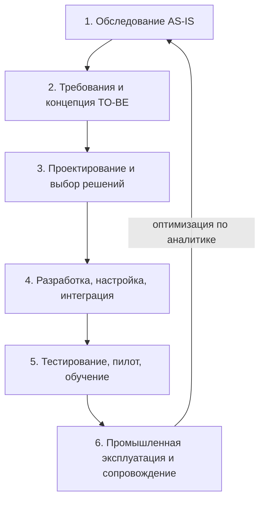

# Менеджмент бизнес-информации

Тема 1 курса. Конспект составлен по презентации лекции (Скворцова Н. А.); транскрипта занятия нет, поэтому разбор лектора не отражён, а формулы со слайдов-картинок записаны в стандартном виде.

## Кратко

- **Информационный менеджмент** = менеджмент бизнес-информации (BIM: данные, информация, знания) + менеджмент ИТ (ITM: инфраструктура, системы) + информационная безопасность + цифровая трансформация.
- BIM отвечает на вопрос «какая информация нужна и насколько она качественна», ITM — «на чём и как это реализовано»; метрики у них разные (качество и скорость доступа против доступности, ROI, TCO).
- Корпоративные информационные ресурсы объединяются в **КИС**; главная цель КИС — единое информационное пространство и быстрые решения на достоверных данных.
- Основные классы КИС: ERP, CRM, SCM, HRM, BI, WMS, EAM, PLM, MIS; при замещении иностранных продуктов вендор выбирается по семи критериям.
- **Информатизация** (внедрение ИТ для поддержки деятельности) и **автоматизация** (замена ручного труда) — разные процессы; эффект ИТ-вложений оценивают через ROI, TCO, PP, SLA, Cost per User, а стоимость компании — через EVA.

## 1. Информационный менеджмент: BIM и ITM

**Информационный менеджмент** — комплексный подход к управлению информационными ресурсами и технологиями организации. Охватывает все решения на всех этапах жизненного цикла предприятия, связанные с информацией в любых формах и состояниях.

Ключевые компоненты:

1. **BIM (Business Information Management)** — управление корпоративной информацией, данными и знаниями.
2. **ITM (IT Management)** — управление ИТ-инфраструктурой, сервисами и решениями.
3. **Информационная безопасность** — защита информационных активов.
4. **Цифровая трансформация** — переход на новые принципы работы с помощью технологий.

Цикл BIM из пяти компонентов:

### Сравнение BIM и ITM

| Аспект | BIM | ITM |
|---|---|---|
| Объект управления | Информация, данные, знания | Технологии, инфраструктура, системы |
| Задачи | Сбор, обработка, анализ, передача информации | Внедрение, поддержка, развитие ИТ-систем |
| Ориентация | На содержание и смысл | На процессы и инструменты |
| Стратегия | Управление информационными активами | Оптимизация ИТ-инвестиций |
| Метрики успеха | Качество информации, скорость доступа | Доступность систем, ROI, TCO |

### Кто отвечает за компоненты

| Компонент | Функции | Ответственный |
|---|---|---|
| BIM | Определение информационных потребностей, управление качеством данных и знаниями | Директор по данным (CDO), руководитель бизнес-аналитики / BI-отдела |
| ITM | Выбор технологий, управление проектами внедрения, техподдержка | ИТ-директор |
| ISM (Information Security Management) | Требования безопасности, аудиты и мониторинг, управление рисками | Руководитель службы безопасности |

### Архитектура предприятия (Enterprise Architecture)

Три уровня архитектуры ИС предприятия:

1. **Стратегический** — ИТ-стратегия, инвестиции, риски.
2. **Управления** — менеджмент бизнес-информации, ИТ-инфраструктуры, безопасности.
3. **Реализации** — Hardware, Software, IT Services.

### Master Data Management (MDM)

**MDM** — система управления мастер-данными, критическая компонента BIM: единые справочники, на которые опираются все прочие системы.

| Тип мастер-данных | Примеры | Управление |
|---|---|---|
| Справочники партнёров | Поставщики, клиенты, подрядчики | Единый реестр, классификация |
| Справочники продуктов | Номенклатура, услуги, акции | Каталогизация, версионирование |
| Справочники контрагентов | Юрлица, персоналии, филиалы | Иерархия, идентификация |
| Финансовые справочники | Бюджеты, ОФР, счета, центры прибыли | Планирование, контроль, аналитика |

### Российский ИТ-рынок 2024–2025

| Показатель | 2024 | 2025 |
|---|---|---|
| Объём рынка, млрд руб. | 2 620 | 3 009 (+15%) |
| Доля в ВВП | 1,5% | 1,8% |
| Рост затрат на ПО | 12% | 15% |
| Рост затрат на оборудование | 11% | 12% |
| Рост затрат на ИТ-услуги | 18% | 22% |

Структура рынка 2025: ПО — 44,3% (быстрее всех растёт, было 41%), ИТ-услуги — 33%, оборудование — 22,7% (было 24,3%).

Тренды:

1. **Импортозамещение и локализация** — отечественные ОС (ALT Linux, Astra Linux), СУБД (Tarantool, Postgres), средства ИБ, ERP; крупнейшие компании (выручка от 25 млрд руб.) закупают отечественные решения в рамках комплексных проектов.
2. **Облака и дата-центры** — рост затрат 22% (против 18%); драйверы — снижение TCO и AI Cloud. Прогноз: доля облачных сервисов с 6% (2026) до 11% (2032).
3. **ИИ и автоматизация** — по опросу экспертов, локомотив развития: ML и ИИ — 33%, облака — 22%, автоматизация и роботизация — 17%.
4. **Цифровая трансформация** — приоритеты: автоматизация процессов, BI, кибербезопасность, мобильность и облака, системы управления знаниями (KMS).

Вызовы рынка: импортозамещение (сертификация, экосистема), кадровый дефицит, рост угроз ИБ и требования к КИИ (ГОСТ), нестабильность внешней среды (санкции, ограничения доступа к платформам).

Поддержка государства: более 4,6 млрд руб. на ИТ-стартапы (2025–2026), нацпроект «Экономика данных» (горизонт 2030). Инвестиции в ИТ за 9 мес. 2025 — 429,4 млрд руб. (+62%), прогноз на год — около 580–600 млрд руб.

### Метрики эффективности ИТ-инвестиций

| Метрика | Что показывает | Целевое значение |
|---|---|---|
| **ROI** | Возврат на инвестиции | 150–300% за 2–3 года |
| **TCO** | Полная стоимость владения | Снижение на 20–40% |
| **SLA** | Уровень доступности сервисов | 99,5–99,9% |
| **Payback Period (PP)** | Период окупаемости | 18–36 месяцев |
| **Cost per User** | Стоимость на пользователя | Снижение на 10–15% в год |

$$ROI = \frac{\text{Доход от инвестиции} - \text{Затраты}}{\text{Затраты}} \cdot 100\%$$

ROI — прибыльность вложений относительно их стоимости.

$$TCO = \text{Приобретение} + \text{Эксплуатация} + \text{Обслуживание} + \text{Утилизация} - \text{Стоимость перепродажи}$$

TCO учитывает все расходы за жизненный цикл актива, а не только цену покупки.

$$PP = \frac{\text{Первоначальные инвестиции}}{\text{Ежегодный денежный поток}}$$

Формула для равномерных денежных потоков: время возврата вложений.

$$\text{Cost per User} = \frac{\text{Общие расходы}}{\text{Число активных пользователей}}$$

Показатель для анализа масштабируемости сервисов.

SLA прямой формулы не имеет: соответствие измеряют через KPI — процент времени безотказной работы (например, 99,9%) и пороги времени ответа со штрафами за нарушение.

## 2. Бизнес-информация как основа бизнес-взаимодействий

- **Бизнес-информация** — информация, имеющая ценность и применяемая в деловой деятельности и управлении: финансы, клиенты, поставщики, рынок, конкуренты, производство, аналитика, маркетинг.
- **Бизнес-взаимодействие** — сотрудничество и коммуникация предприятий, организаций, ИП ради общих целей.

### Пятиуровневая модель цифровизации

| Уровень | Характеристика | Инициативы |
|---|---|---|
| 1. Initial | Цифровых процессов нет | Рассмотрение вариантов |
| 2. Managed | Единичные автоматизированные процессы | Пилотные проекты |
| 3. Defined | Стандартизация цифровых процессов | Масштабирование решений |
| 4. Optimized | Полная интеграция цифровых технологий | ИИ, ML, аналитика |
| 5. Predictive | Прогнозная аналитика | Трансформация бизнес-моделей |

### Внедрение информационного менеджмента в 5 этапов

1. **Видение и стратегия:** связать ИТ- и бизнес-стратегию, проанализировать показатели, задать KPI, получить поддержку топ-менеджмента.
2. **Оценка текущего состояния:** аудит инфраструктуры, анализ информационных потребностей, оценка зрелости процессов.
3. **План трансформации:** выбор решений и поставщиков, приоритеты проектов, бюджет и ресурсы.
4. **Поэтапное внедрение:** пилоты → масштабирование → обучение пользователей.
5. **Постоянное улучшение:** мониторинг и аналитика, пересмотр стратегии, адаптация к новым технологиям.

К 2025 г. около 30% корпоративного дохода в мире, по прогнозу McKinsey, будут приносить цифровые бизнес-экосистемы.

## 3. Корпоративные информационные ресурсы, форма и содержание

**Корпоративные информационные ресурсы** — структурированная и неструктурированная информация, данные, документы и знания, накопленные организацией и используемые для её хозяйственной деятельности (внутренней и внешней). Они объединяются в **корпоративные информационные системы (КИС)**.

**Категории ресурсов:**

1. Базы и хранилища данных.
2. Сетевая инфраструктура (хранилища, серверы, сети, связь).
3. Системы управления предприятием (ERP).
4. Корпоративные приложения и ПО.
5. Внутренние порталы и сайты.
6. Документы и файлы.

**Форма** (носители): бумажные документы, электронные файлы, базы данных, облачные сервисы.
**Содержание:** документы (справки, приказы, контракты), данные (финансовые, технические, производственные), знания (процессы, методики, лучшие практики), медиа-контент, архивы.

**Главная цель КИС** — повышение эффективности бизнеса. Задачи:

- связать информационные потоки подразделений в едином информационном пространстве;
- повысить оперативность получения информации и её качество;
- ускорить решения и снизить риски за счёт достоверных входных данных.

**Уровни консолидации информации:** предприятий (филиалы, дочерние компании, холдинг), отдельных задач, временных периодов (анализ дольше отчётного периода), форм отчётности (управленческая, финансовая, статистическая, налоговая).

**Единое информационное пространство (ЕИП)** — интегрированная система, обеспечивающая согласованную работу всех информационных ресурсов ради стратегических целей. Три свойства: интеграция (связь систем), синхронизация (согласованность данных), скорость (оперативный доступ).

**Принципы управления информационными ресурсами:** централизованное хранение, классификация, защита данных (контроль доступа), резервное копирование.

**Вызовы и решения:**

| Вызов | Решение |
|---|---|
| Информационный беспорядок | BI и аналитические системы |
| Утечки данных | Системы шифрования |
| Избыточность информации | Облачные технологии |
| Непригодность данных | Стандартизация процессов |

### Классы КИС

| Тип | Назначение | Основные функции | Аудитория |
|---|---|---|---|
| **ERP** | Управление ресурсами | Производство, учёт, финансы, логистика | Промышленные, производственные |
| **CRM** | Управление клиентами | Продажи, маркетинг, обслуживание; воронка, омниканальность | Торговля, услуги, дистрибуция |
| **SCM** | Цепи поставок | Прогноз спроса, закупки, логистика, запасы, обратная логистика | Логистика, ритейл, дистрибьюторы |
| **HRM** | Управление персоналом | Кадровый учёт, подбор, зарплата и льготы, оценка, обучение | Все организации |
| **BI** | Аналитика данных | Интеграция данных, отчёты, дашборды, прогнозы | Управление всех уровней |
| **WMS** | Управление складом | Приёмка, размещение (слоттинг), комплектация, инвентаризация, маршруты | Логистика, ритейл, дистрибуция |
| **EAM** | Управление активами | Реестр оборудования, ТО и ремонты, запчасти, надёжность, затраты | Производство, энергетика, ЖКХ |
| **PLM** | Жизненный цикл продукции | Проектирование, конструкторская документация, версионирование, сертификация | Машиностроение, приборостроение, ВПК |
| **MIS** | Информационное управление | Сбор данных, отчётность, мониторинг KPI | Все типы организаций |

Российские и мировые аналоги (по слайду): WMS — 1С:Логистика, LogicSoft (аналог — Кобо, JDA); EAM — Инталев, Гарант (SAP PM, Oracle Maximo); PLM — ASCON Kompas, Лоцис (Siemens Teamcenter, PTC Windchill); MIS — 1С:Аналитика (Qlik, MicroStrategy, IBM Cognos).

### Финансовый и кадровый блоки КИС

- **Управление затратами:** калькуляция себестоимости, элементы затрат, прямые и косвенные затраты, учёт по местам возникновения и процессам, анализ план-факт, управленческая отчётность.
- **Основные данные финансового блока:** область бизнеса, виды деятельности, план счетов, банковские реквизиты, центры затрат и их иерархия.
- **Управление инвестициями:** расчёт инвестиционных мероприятий, бюджеты инвестпрограмм, учёт и мониторинг финансирования.
- **Администрирование персонала:** основные данные, кадровое делопроизводство, учёт рабочего времени, справки. Развитая функциональность: планирование потребности в кадрах, карьера, обучение, менеджмент вознаграждения (бонус зависит от KRI сотрудника), расчёт больничных и отпускных.
- **Анализ состояния системы:** архитектура БД, эффективность алгоритмов, статистика (записи, документы, транзакции), журналы операций, объём дисков, список рабочих станций.
- **BSC (сбалансированная карта показателей)** — инструмент связи КИС со стратегическим менеджментом: функциональные стратегии раскладываются в стратегическую карту.

### Территориальная локализация КИС и выбор вендора

Шаги локализации:

1. Определить перечень ИТ-систем, нужных локальной компании.
2. Разделить их на критические, необходимые и прочие.
3. Разработать план коммуникаций для клиентов и пользователей.
4. Получить демо критических и необходимых продуктов, обновлять план по срокам.
5. Мигрировать пользователей: пилот, затем все.
6. Внедрить менее критичные сервисы.

**Каким должен быть вендор:**

1. Локальный продукт, вендор вне санкционных списков («не замещайте на то, что может уйти или отказать»).
2. Продукт не первый день на рынке, есть отзывы и кейсы.
3. Есть демо/триал (сроки внедрения нужно соотнести со сроком теста: 14 дней для корпоративного сервиса мало).
4. Вендор поддерживает и обновляет продукт после внедрения.
5. На рынке есть компании-внедренцы и поддержки.
6. Есть интеграции с планируемыми продуктами.
7. Соответствие требованиям безопасности.

## 4. Информатизация и автоматизация предприятий

| | Информатизация | Автоматизация |
|---|---|---|
| Суть | Внедрение ИТ и систем для поддержки хозяйственной деятельности | Замена или упрощение ручных операций автоматическими системами |
| Цель | Эффективность, рост производительности, оптимизация ресурсов, качество | Снижение объёма ручного труда в бизнес-процессах |

**Цели информатизации:** повышение эффективности (меньше рутины), снижение затрат, улучшение контроля (аналитика и мониторинг), конкурентоспособность, улучшение обслуживания, безопасность данных и соответствие нормативам.

**Статистика по РФ (2024–2025):** 87,5% компаний планируют автоматизацию в 2024–2026; 56% внедрили автоматизацию процессов; 44% используют цифровые экосистемы; 39% внедрили ИИ.

### Этапы информатизации

### Этапы автоматизации бизнес-процессов

1. Ресурсы и производство: планирование, MES, запасы, качество, диспетчеризация.
2. Финансы и учёт: расчёт налогов, отчётность, бюджетирование.
3. Продажи и обслуживание: CRM, омниканальные коммуникации, автоворонки.
4. Кадры: кадровый учёт, зарплата, электронный документооборот, обучение.
5. Документооборот и согласование: ECM/BPM, электронная подпись, маршруты согласований.

Проще всего автоматизировать типовые операции: управление продажами, рассылки (email, push, SMS), документооборот, платежи, складской и бухгалтерский учёт.

### Технологии автоматизации

| Технология | Назначение | Особенность |
|---|---|---|
| RPA | Автоматизация рутинных задач (финансы, кадры) | Быстрое внедрение, ROI за 6–9 месяцев |
| BPM/BPA | Моделирование процессов | Визуализация и улучшение процессов |
| AI/ML | Интеллектуальная обработка, прогнозирование | Предсказательные модели |
| IoT | Сбор данных с оборудования | Контроль технологических процессов |
| Cloud | Облачные вычисления | Гибкость, масштабируемость |
| API | Интеграция систем | Единое информационное пространство |

Российские решения (по слайду): RPA — 1С:Рабочее место (аналог — UiPath, Blue Prism); BPM — Диасофт Process, ARIS; ИИ — Яндекс.Cloud AI, МТС DeepTech; IoT — Rostelecom IoT, Инталев; облака — Яндекс.Cloud, МТС Вертикаль, Ростелеком.

ИИ помогает: улучшить обслуживание клиентов (персонализация), повысить эффективность сотрудников, принимать управленческие решения, прогнозировать спрос, предотвращать простои оборудования.

### Управление стоимостью компании

$$EVA = NOPAT - WACC \cdot \text{Инвестированный капитал}$$

**EVA** (экономическая добавленная стоимость) — прибыль после налогов за вычетом платы за использованный капитал. Положительная EVA означает, что компания зарабатывает больше стоимости привлечённого капитала. NOPAT — операционная прибыль после налогов, WACC — средневзвешенная стоимость капитала.

## Вывод по теме

Информационный менеджмент задаёт правила работы с информацией (что собирается, как хранится, шифруется и используется), автоматизация превращает эти правила в ИТ-системы, регламенты и сервисы. Результат — более устойчивое управление, снижение затрат и ошибок, рост скорости решений.

## Термины

| Термин | Значение |
|---|---|
| BIM | Менеджмент бизнес-информации: управление данными, информацией и знаниями |
| ITM | Менеджмент информационных технологий: управление инфраструктурой и решениями |
| ISM | Менеджмент информационной безопасности |
| MDM | Управление мастер-данными (единые справочники) |
| КИС | Корпоративная информационная система |
| ЕИП | Единое информационное пространство организации |
| CDO | Chief Data Officer, директор по данным |
| SLA | Соглашение об уровне обслуживания |
| TCO | Полная стоимость владения |
| PP | Период окупаемости |
| EVA | Экономическая добавленная стоимость |
| BSC | Сбалансированная карта показателей |
| AS-IS / TO-BE | Состояние «как есть» / «как должно быть» |
