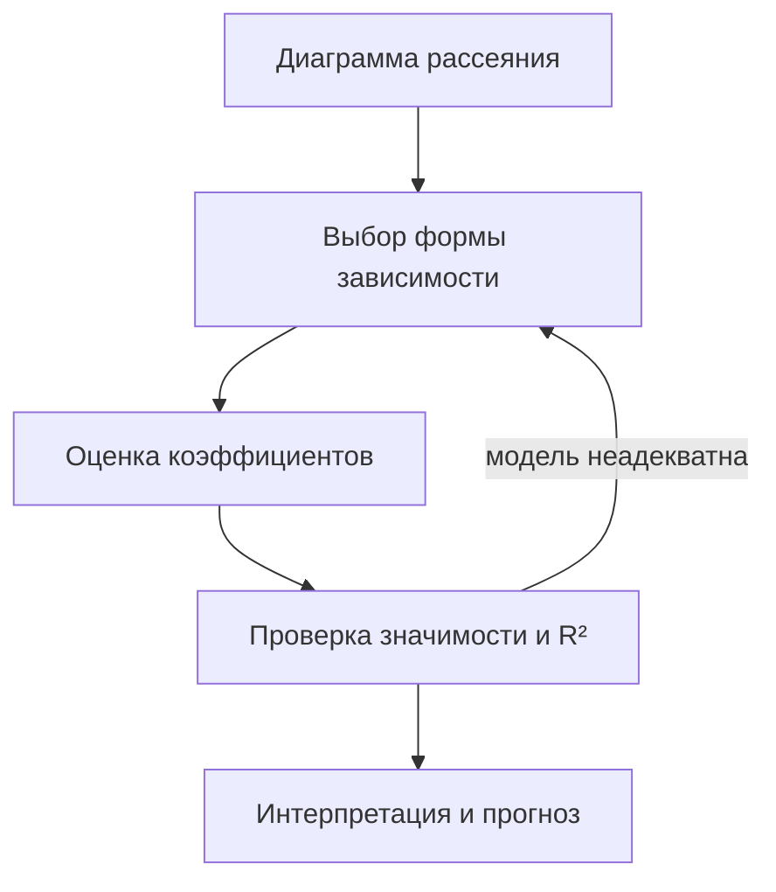

# Классическая модель парной линейной регрессии

## Кратко

- Эконометрика решает две задачи: **прогноз** значения зависимой переменной и **анализ структуры** — экономический смысл коэффициентов.
- Модель парной регрессии: $y = \alpha + \beta x + \varepsilon$. Всё, что не объяснено единственным фактором $x$, уходит в случайный член $\varepsilon$.
- Любое исследование начинается с диаграммы рассеяния. Модель без взгляда на график — типичная ошибка, за которую снижают оценку.
- $R^2$ — доля дисперсии $y$, объяснённая моделью. Высокий $R^2$ сам по себе не делает модель адекватной.
- Коэффициент $b$ — изменение $y$ при росте $x$ на единицу, то есть «очищенная» от прочих факторов цена единицы фактора. Свободный член $a$ экономического смысла обычно не имеет.
- Для адекватной модели нужно не менее 30 наблюдений (25 — если заведомо выполнены условия Гаусса—Маркова).

## Место дисциплины

Курс делится на две несхожие части — методы матмоделирования зависят от области применения:

1. **Эконометрика** — построение регрессионных моделей.
2. **Моделирование систем массового обслуживания.**

Эконометрика — живая, развивающаяся математика: в отличие от матанализа с материалом двухсотлетней давности, методы обновляются постоянно. Пример: подход, при котором гетероскедастичность сначала детектируют, а затем на той же выборке от неё избавляются, ~15 лет назад признан математически некорректным, хотя в компаниях применялся ещё долго.

Как матстатистика и многомерные статметоды, эконометрика неприменима в отрыве от реальности. Однозначно правильных и неправильных моделей нет: два опытных эконометриста построят разные, хотя и близкие модели.

## Две задачи эконометрики

| Задача | Суть | Разновидности |
|---|---|---|
| Прогноз | Подставить нужное значение $x$ в уравнение и получить $y$ | **интерполяция** — значение внутри диапазона выборки; **экстраполяция** — за его пределами (прогноз цены нефти на следующий квартал) |
| Анализ структуры | Выяснить экономический смысл коэффициентов модели | цена единицы фактора, эластичность |

Сквозной пример для обеих задач: 10 наблюдений «площадь квартиры (кв. футы) — цена (тыс. \$)».

Зачем модель: нужной площади (1500 кв. футов) в выборке нет; а даже если бы была — одной площади реально соответствует не одна цена, а диапазон. Регрессионная связь и означает: каждому $x$ соответствует диапазон значений $y$.

## Порядок работы



## Модель и её составляющие

$$y = \alpha + \beta x + \varepsilon$$

$y$ состоит из неслучайной составляющей $\alpha + \beta x$ ($x$ — объясняющая, независимая переменная) и **случайного члена** $\varepsilon$. В $\varepsilon$ уходит влияние всех неучтённых факторов: для цены квартиры — этаж, материал дома, ремонт, район, транспортная доступность, соседи, субъективные предпочтения покупателя.

Точные $\alpha$ и $\beta$ по выборке не найти — только оценить; оценки обозначают $a$, $b$, оценённое уравнение $\hat{y} = a + bx$. Формальный разбор оценок, МНК и условий доверия к модели — в [лекции 2](02-mnk-teorema-gaussa-markova.md).

## Выбор формы зависимости

В Excel линия тренда строится в один клик — соблазн взять первую форму велик. Сравнение на данных о квартирах:

| Модель | $R^2$ | Что не так |
|---|---|---|
| Линейная | ≈ 0,80 | прямая плохо ложится на облако точек |
| Полином 2-й степени | ≈ 0,90 | после вершины парабола идёт вниз: цена падает с ростом площади — бессмыслица |
| Логарифмическая | ≈ 0,89 | экономически осмысленна, $R^2$ почти как у параболы |

Формальное качество подгонки и содержательная осмысленность — разные вещи. Парабола выигрывает по $R^2$, но её поведение при больших площадях противоречит предметной области.

## Коэффициент детерминации

**Дисперсия** — мера изменчивости величины: отклонения каждого наблюдения от среднего возводятся в квадрат (чтобы плюсы и минусы не сократились — сумма отклонений от среднего строго равна нулю) и усредняются.

$$\mathrm{Var}(y) = \frac{1}{n}\sum_{i=1}^{n}(y_i - \bar{y})^2$$

Модуль вместо квадрата не берут: в методе наименьших квадратов он не работает.

**Коэффициент детерминации $R^2$** — доля дисперсии $y$, объяснённая уравнением регрессии. При $R^2 = 0{,}90$ изменчивость цены на 90% объясняется изменчивостью площади, оставшиеся 10% — все прочие факторы и необъяснённая случайность. Максимум $R^2 = 1$ (все остатки нулевые); при отсутствии линейной связи $R^2$ близок к нулю.

## Интерпретация коэффициентов

Для линейной модели цены квартиры $\hat{y} = 0{,}1065x + 92$ (цена в тыс. \$, площадь в кв. футах):

- **$b = 0{,}1065$** — изменение цены при росте площади на квадратный фут, то есть цена одного квадратного фута: 106,5 \$.
- **$a = 92$** — формально цена квартиры площадью 0. Прямого смысла не имеет: $x = 0$ лежит далеко за пределами выборки.

Почему $b$ лучше, чем «суммарная цена / суммарная площадь»: простое частное вбирает влияние этажа, материала дома, района и всего прочего, а коэффициент регрессии даёт цену метра **в чистом виде** — это и есть решение задачи анализа структуры.

## Когда одной кривой мало

Облако точек распадается на два участка: примерно до 100 кв. м работает одна модель ценообразования, выше — другая. Содержательно правдоподобно: у покупателя квартиры 35 кв. м и покупателя 220 кв. м разные требования и разные механизмы формирования цены. Непрерывная кривая через оба участка сомнительна.

Как оформить:

- **Разбить выборку на две подвыборки** — плохо: из 30 наблюдений получится две по 15, надёжных выводов не сделать.
- **Ввести фиктивную переменную** (0 для одной группы, 1 для другой) — выборка фактически делится, а число степеней свободы падает незначительно.

Термин «фиктивная переменная» — неудачный перевод; в литературе чаще *dummy-переменная*. Кластеризация здесь избыточна: это метод многомерного статанализа, задача решается проще.

## Требования к данным

- **Объём выборки:** не менее 30 наблюдений; 25 — если заранее известно, что условия Гаусса—Маркова выполнены. 10 наблюдений — заведомо мало.
- **Выбросы:** чаще их удаляют, но подход спорный. Удаляя выброс, мы подгоняем действительность под удобную модель, тогда как задача обратная — построить модель действительности. Если можно обойтись без удаления, лучше так и сделать.

## Практика: R и вывод `summary`

Расчёты ведутся на **R** и **Python**. R старше Python, написан статистиками для статистиков, потому в статзадачах читается проще. Он же — фактический стандарт публикаций: западные журналы требуют выкладывать со статьёй данные и код на R для воспроизводимости.

Пример на данных «возраст — опыт — доход», 20 наблюдений:

```r
df <- read.csv("data.csv", sep = ",", dec = ".")
str(df)            # структура фрейма данных
x <- df$Возраст
y <- df$Доход
model <- lm(y ~ x) # линейная модель: y зависит от x
summary(model)
```

**Фрейм данных** отличается от матрицы тем, что столбцы могут иметь разный тип. Если в R-коде появился цикл `for`, программу почти наверняка можно переписать через векторные операции — они заметно эффективнее.

Что читать в выводе `summary`:

| Показатель | Смысл |
|---|---|
| `Estimate` при `x` | коэффициент $b$: на столько меняется $y$ при росте $x$ на единицу |
| `Estimate` `(Intercept)` | свободный член $a$ |
| `Multiple R-squared` | доля объяснённой дисперсии |
| `Adjusted R-squared` | то же со штрафом за каждую новую переменную; показывает, оправдано ли включение доп. регрессоров. Всегда чуть меньше обычного $R^2$ |
| `p-value` (в конце вывода) | значимость уравнения в целом |
| `Pr(>\|t\|)` | значимость отдельного коэффициента |

**Правило 0,05:** `p-value` уравнения > 0,05 — регрессия в целом незначима, $y$ от $x$ не зависит, работать не с чем; меньше — уравнение значимо. Так же читаются `Pr(>|t|)` по коэффициентам: значимые удерживаются. В парной регрессии `p-value` уравнения и `Pr(>|t|)` при $x$ совпадают — не случайность.

В примере $R^2 = 0{,}28$: возрастом объясняется лишь 28% изменчивости дохода. График объясняет почему: в среднем доход растёт примерно до 45 лет, затем снижается, так что линейная модель не работает в принципе. Плюс одно аномальное наблюдение: 60-летний человек с очень высокой зарплатой.

> [!IMPORTANT]
> Строить модель до просмотра графика — типичная студенческая ошибка, за которую оценка резко снижается. Хороший $R^2$ не оправдание.

## Инструменты курса

| Инструмент | Назначение |
|---|---|
| R | основной язык; стандарт воспроизводимых эконометрических расчётов, десятки тысяч библиотек |
| Python | второй язык; часть библиотек перенесена из R, в том числе `ggplot2` — в Python-варианте логичнее |
| Excel | быстрая визуализация и линии тренда |
| Gretl | графическая среда с современными эконометрическими методами |
| GPSS | моделирование систем массового обслуживания (вторая часть курса) |

## Термины

| Термин | Значение |
|---|---|
| Объём выборки $n$ | число пар наблюдений $(x_i, y_i)$ |
| Диаграмма рассеяния | график исходных пар наблюдений — первый шаг любого исследования |
| Уравнение регрессии | $y = \alpha + \beta x + \varepsilon$; $\alpha$, $\beta$ — коэффициенты регрессии |
| Случайный член $\varepsilon$ | совокупное влияние факторов, не вошедших в уравнение |
| Дисперсия | мера разброса величины вокруг среднего |
| $R^2$ | доля дисперсии $y$, объяснённая уравнением регрессии |
| Скорректированный $R^2$ | $R^2$ со штрафом за число включённых переменных |
| Фиктивная (dummy) переменная | переменная-индикатор 0/1, разделяющая выборку на группы внутри одной модели |
| Интерполяция / экстраполяция | прогноз внутри диапазона выборки / за его пределами |
| Выброс | аномальное наблюдение, резко отклоняющееся от общей закономерности |

> [!IMPORTANT]
> **Организация курса и экзамен:** 4 темы — 4 лабораторные и 4 домашних задания. Экзамен устный, дистанционный, билет из трёх вопросов: общее понимание матмоделирования (10 баллов), разбор ситуации (10), решение практической задачи (20). За семестр — до 60 баллов, плюс до 15 бонусных за активность. Шкала: 50 → «3», 70 → «4», 90 → «5». Возможны автоматы. Полный список вопросов — в личном кабинете.
