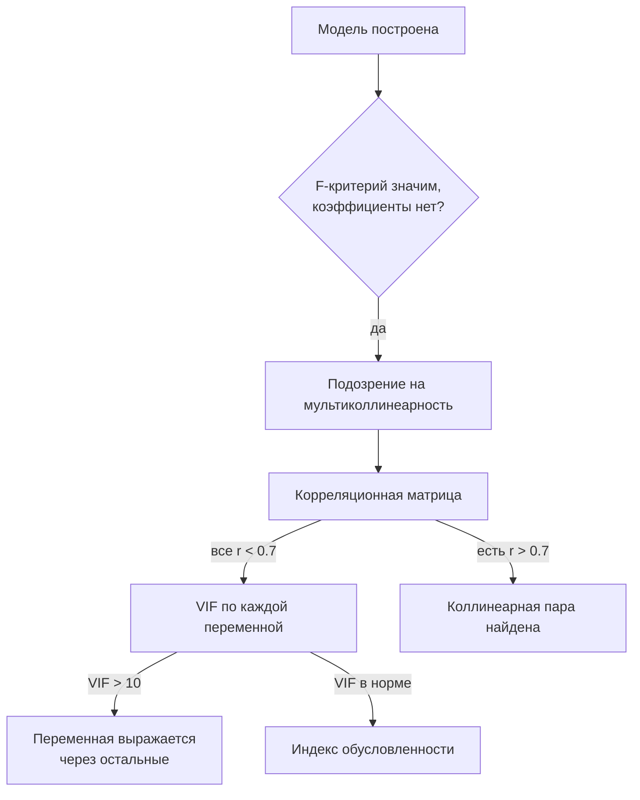

# Мультиколлинеарность: природа, признаки и диагностика

## Кратко

- Корреляция между регрессорами есть **всегда**: у работающей системы факторы связаны. Бороться нужно не с явлением, а только с сильно выраженной мультиколлинеарностью.
- При полной коллинеарности ($r = \pm 1$) формулы МНК дают $0/0$ — коэффициенты не вычисляются, программа сообщает о сингулярности.
- При почти полной коллинеарности ($r \approx 0{,}99$) коэффициенты вычисляются, но это численный мусор: разрядность компьютера конечна, а близкие числа вычитаются.
- Главный клинический признак — регрессия значима по F-критерию, а все или почти все коэффициенты по отдельности незначимы.
- Формальная диагностика: корреляционная матрица (порог $0{,}7$), VIF (порог $10$), индекс обусловленности (порог $30$).
- Предпосылки теоремы Гаусса—Маркова не нарушаются: оценки остаются несмещёнными, просто их дисперсия (и стандартные ошибки) слишком велика.

## Что мы оцениваем и чему можно доверять

Модель множественной регрессии:

$$Y = \alpha + \beta_1 X_1 + \beta_2 X_2 + \varepsilon$$

- $Y$ — зависимая переменная (объём продаж), $X_1, X_2$ — **регрессоры** (объясняющие переменные): цена, рекламный бюджет.
- $\alpha, \beta_1, \beta_2$ — **истинные коэффициенты**, точно не узнаваемые никогда.
- $\varepsilon$ — **случайный член**. В него входят факторы двух типов: по-настоящему случайные события и закономерные, но мелкие разнонаправленные факторы, не заслужившие отдельной переменной.

По выборке считаются **оценки** $a, b_1, b_2$ и **остатки регрессии** $e$ (в численных методах — невязки).

Оценки считаются по **одной** выборке. Будь их несколько, коэффициенты отличались бы **незначимо** — за счёт случайных факторов при одинаковых матожиданиях.

Следствие: если реально $\beta_2 = 0$, оценка $b_2$ **всё равно не будет нулевой** — она отлична от нуля, но **незначима**: по разным выборкам скачет то в плюс, то в минус вокруг нуля без системы. Значимый коэффициент колеблется вокруг ненулевого значения.

> [!IMPORTANT]
> Никаким данным нельзя доверять на 100%. Работаем не с истиной, а с вероятностью того, что вывод верен. Ошибка «признал значимым незначимое» и ошибка «признал незначимым значимое» — разные, одна из другой не пересчитывается.

## Природа мультиколлинеарности

**Мультиколлинеарность** (multicollinearity) — линейная зависимость между объясняющими переменными. Различают два вида:

| Вид | Что означает |
|---|---|
| Полная | Функциональная (тождественная) линейная зависимость регрессоров |
| Частичная (или просто мультиколлинеарность) | Более или менее сильная корреляция факторов |

В терминологии лектора связь **двух** регрессоров — **коллинеарность**, трёх и более — мультиколлинеарность.

Ключевое: все предпосылки теоремы Гаусса—Маркова **выполнены**, оценки несмещённые — но их дисперсия слишком высока, отсюда большие стандартные ошибки и низкая значимость коэффициентов.

У работающей системы факторы взаимосвязаны по определению, иначе система разваливается; значит, их количественные выражения коррелируют. Корреляция регрессоров — норма, а не патология.

> [!NOTE]
> Мультиколлинеарность **не обязательно** даёт плохие оценки. Если наблюдений много, выборочные дисперсии регрессоров велики, а дисперсия случайного члена мала — результат может быть приличным. Устранять её начинают, только когда она серьёзно влияет на оценку.

### Предельный случай: доведение до абсурда

Приём для понимания механизма: взять крайний вариант связи и посмотреть, что сломается. Пусть

$$X_2 = k X_1$$

Тогда $r = 1$ (при $k > 0$) или $r = -1$ (при $k < 0$). Оценка первого коэффициента в модели с двумя регрессорами:

$$b_1 = \frac{\mathrm{Cov}(x_1, y)\,\mathrm{Var}(x_2) - \mathrm{Cov}(x_2, y)\,\mathrm{Cov}(x_1, x_2)}{\mathrm{Var}(x_1)\,\mathrm{Var}(x_2) - \mathrm{Cov}^2(x_1, x_2)}$$

Подставив $x_2 = k x_1$, в числителе получаем два одинаковых вычитающихся слагаемых, то же в знаменателе:

$$b_1 = \frac{k^2\,\mathrm{Cov}(x_1, y)\,\mathrm{Var}(x_1) - k^2\,\mathrm{Cov}(x_1, y)\,\mathrm{Var}(x_1)}{k^2\,\mathrm{Var}^2(x_1) - k^2\,\mathrm{Var}^2(x_1)} = \frac{0}{0}$$

Причина в свойствах: ковариация — билинейная форма, $k$ выносится в первой степени; дисперсия — квадратичная, $k$ выносится в квадрате. Числитель и знаменатель обнуляются одновременно.

Связь $X_2 = k X_1 + d$ ничего не меняет: ковариация с константой и дисперсия константы равны нулю, $d$ выпадает.

Содержательно: $X_1$ и $X_2$ здесь — **одна величина в разных единицах** (кг и граммы, доллары и рубли). Регрессор один, записан дважды.

Что видит программа: Excel — деление на ноль, EViews — «сингулярность»; посчитать не может ни одна.

### Почти полная коллинеарность и численный мусор

Пусть $r = 0{,}999$. Точного $0/0$ нет, коэффициент формально вычислится, но результат — мусор.

Дробные числа в компьютере хранятся с конечной разрядностью (точно — лишь степени двойки). При $r = 0{,}999$ первые три значащие цифры уменьшаемого и вычитаемого совпадают; при вычитании значимая часть уничтожается, остаётся разность округлительных хвостов — шум. Такой же шум в знаменателе. Итог: $b_1$ — шум, делённый на шум.

Усугубляет накопление ошибки: каждая операция портит примерно половину последнего разряда. Много переменных → много вычислений → значимых разрядов не остаётся.

Следствие: чуть пошевелить выборку — и коэффициент меняется в разы и меняет знак; предсказать как — нельзя.

## Признаки выраженной мультиколлинеарности

Слабая мультиколлинеарность есть всегда — как температура 37,1: бороться незачем. Нужны признаки того, что стало «38».

| Признак | Что означает |
|---|---|
| Регрессия значима по F-критерию, но все или почти все коэффициенты незначимы | Парадокс: $Y$ зависит от набора иксов, но не зависит ни от одного по отдельности. Самый явный симптом |
| Малое изменение данных сильно меняет оценки | Удалили 1 наблюдение из 30 (≈3%) — коэффициент изменился вдвое или впятеро. Норма — изменение того же порядка, что и данных, максимум единицы процентов |
| Неправильный знак коэффициента | В модели $P = a + b \cdot S$ коэффициент $b$ (цена метра) отрицателен: больше квартира — дешевле, бессмыслица |
| Неоправданно большие или малые значения | Цена квадратного метра ≈ 1,43 ₽. «Неоправданно большое» распознать труднее, чем «малое» |

> [!WARNING]
> Проверяя устойчивость, удаляйте **несколько разных** наблюдений по очереди. Одиночное удаление может попасть во **влиятельное наблюдение**, которое само сильно двигает коэффициенты. Влиятельность удобно показывать на диаграмме рассеяния кружками разного радиуса.

## Формальная диагностика



### Корреляционная матрица

Матрица парных коэффициентов корреляции регрессоров, симметричная относительно главной диагонали:

$$R = \begin{pmatrix} 1 & r_{x_2 x_1} & \dots & r_{x_k x_1} \\ r_{x_1 x_2} & 1 & \dots & r_{x_k x_2} \\ \dots & \dots & \dots & \dots \\ r_{x_1 x_k} & r_{x_2 x_k} & \dots & 1 \end{pmatrix}$$

Порог: $r_{x_i x_j} > 0{,}7$ — переменные явно коллинеарны.

Ограничение: ловит только **парные** связи. Переменная может точно выражаться через две другие, попарно коррелируя с каждой слабо.

### VIF (Variance Inflation Factor)

Фактор инфляции дисперсии — для поиска именно **множественных** связей:

$$\mathrm{VIF}_i = \frac{1}{1 - R_i^2}$$

$R_i^2$ — коэффициент детерминации вспомогательной регрессии $X_i$ на **все остальные** регрессоры (не $Y$ на иксы!). Для трёх переменных строится три регрессии: $X_1$ на $X_2, X_3$; $X_2$ на $X_1, X_3$; $X_3$ на $X_1, X_2$.

Порог: $\mathrm{VIF}_i > 10$ — мультиколлинеарность есть. Это то же, что $R_i^2 > 0{,}9$: при $R_i^2 = 0{,}9$ выходит $1/(1-0{,}9) = 10$.

Диагностика: большой $\mathrm{VIF}_2$ означает, что вторая переменная с высокой точностью восстанавливается по остальным и, скорее всего, лишняя.

> [!NOTE]
> Дополнительной информации к $R_i^2$ показатель VIF не несёт — судить можно и по $R_i^2$; это традиция, а не математика. Порог по $R_i^2$ принято брать мягче: уже выше $0{,}6$ — признак мультиколлинеарности, тогда как $\mathrm{VIF} > 10$ соответствует $R_i^2 > 0{,}9$.

> [!IMPORTANT]
> Нужно уметь считать VIF руками по $R_j^2$ вспомогательных регрессий, а не только вызывать `vif()` из пакета `car`.

### Индекс обусловленности (condition index)

Работает с матричной формой:

$$Y = X\beta + \varepsilon$$

$X$ — матрица объясняющих переменных $n \times k$, к которой слева дописан **столбец единиц** (нужен для оценки свободного члена $a$):

$$X = \begin{pmatrix} 1 & x_{12} & \dots & x_{1k} \\ \dots & \dots & \dots & \dots \\ 1 & x_{n2} & \dots & x_{nk} \end{pmatrix}$$

Строится матрица $X'X$ ($X'$ — транспонированная), вычисляются её собственные значения $\lambda$:

$$\mathrm{CI} = \sqrt{\frac{\lambda_{\max}}{\lambda_{\min}}}$$

Порог: $\mathrm{CI} > 30$ — матрица **плохо обусловлена**, близка к вырожденной (есть $\lambda$ около нуля). Операции с ней, прежде всего обращение, дают численный мусор.

Граница 30 не строгая: по сути мультиколлинеарность — субъективное недовольство исследователя слишком высокими стандартными ошибками.

Аналогия: в теории дифференциальных уравнений такая система называется **жёсткой**, обычные методы (Рунге—Кутты) к ней неприменимы, нужны специальные.

## Практика: цены квартир в Москве (R)

Датасет 20–25-летней давности: площади в кв. м, цена в долларах.

| Переменная | Смысл |
|---|---|
| `price` | цена квартиры |
| `totsp` | общая площадь |
| `livesp` | жилая площадь |
| `kitsp` | площадь кухни |
| `dist` | расстояние до центра, км |
| `metrdist` | расстояние до метро, минут пешком |
| `walk` | метро в шаговой доступности: 1 — да, 0 — нет |
| `brick` | материал: 1 — кирпич, 0 — панель |
| `floor` | 1 — средние этажи, 0 — первый или последний |
| `code` | код района |

Библиотеки: `car` (VIF) и `dplyr` (обработка данных; аналог в Python — `pandas`).

Ход работы и результаты:

1. **Диаграмма рассеяния «цена — общая площадь»** показывает **гетероскедастичность**: разброс цен растёт с площадью. Естественно — разброс для 32 кв. м и 125 кв. м несопоставим.
2. **Логарифмирование** обеих переменных выравнивает картину. Более общий инструмент — **преобразование Бокса—Кокса** с параметром $\lambda$: при $\lambda = 1$ линейное (смена единиц), при $\lambda = 0$ — логарифмическое, промежуточные $\lambda$ дают промежуточный результат.
3. **Корреляционная матрица** трёх площадей (логарифмы): `totsp`—`livesp` $= 0{,}84$, `totsp`—`kitsp` $= 0{,}77$, `livesp`—`kitsp` $= 0{,}50$. Все положительны — больше одна площадь, больше остальные.
4. **На нелогарифмированных данных**: $0{,}85$, $0{,}75$, $0{,}54$. Изменения количественные, не качественные — логарифмирование связи не создаёт и не убирает.
5. **Индекс обусловленности** для матрицы логарифмов: $\mathrm{CI} = 203$ при пороге 30. Коэффициентам доверять нельзя.

```r
X  <- as.matrix(f[, c("ltotsp", "llivesp", "lkitsp")])
ev <- eigen(t(X) %*% X)$values
(CI <- sqrt(max(ev) / min(ev)))
```

Внешние скобки вокруг присваивания заставляют R и посчитать, и вывести результат.

6. **Оценка регрессии** (`lm` + `summary`) подтверждает диагноз:
    - F-статистика: `p-value < 2.2e-16` — модель значима практически со 100%-й надёжностью (`2.2e-16` — минимальное представимое число, фактически ноль);
    - из четырёх коэффициентов значим один: p-value остальных — 0,58, 0,34 и 0,58.

Это тот самый парадокс из таблицы признаков.

## Проверка гипотез: как читать p-value

Порядок стандартный:

1. **Нулевая гипотеза $H_0$** — всегда об **отсутствии различий**: коэффициент равен нулю, распределение не отличается от нормального. Формулируется механически — здесь думать вредно.
2. **Альтернативная гипотеза $H_1$** — что принимается, если $H_0$ неверна. Её формулировка требует понимания задачи (односторонний критерий или двусторонний).
3. **Уровень значимости $\alpha$** — максимальная вероятность ошибки, которую мы **сами себе** разрешаем: отвергнуть $H_0$, когда она верна (ошибка первого рода). В экономике и психологии $\alpha = 0{,}05$.
4. **p-value** — фактическая вероятность такой ошибки для конкретного коэффициента.

Правило: $p < \alpha$ → отвергаем $H_0$, коэффициент значим. $p > \alpha$ → оставляем $H_0$, незначим.

В примере выше $p = 0{,}58$ — ошибиться можно в 58% случаев, отвергать $H_0$ нельзя.

> [!IMPORTANT]
> **Автокорреляция** на занятиях не разбирается: курс о эконометрике **пространственных** данных, где наблюдения относятся к одному моменту и их можно перемешать — автокорреляция исчезает. Она принципиальна лишь для временных рядов с хронологическим неизменяемым порядком. **Но экзаменационные вопросы по автокоррелированности есть** — тема на самостоятельное изучение, на неё отведён больший объём часов, чем на аудиторные занятия.

> [!TIP]
> Лабораторный практикум — на Python (Google Colab). ИИ и интернет разрешены: задача в том, чтобы решить, а не набить руку вручную. Возможный формат задания — перенос R-кода на Python.

## Есть в слайдах, но не разбиралось

На паре разбирался пример с квартирами; в презентации «Мультиколлинеарность. Часть 1» тот же материал показан на встроенном датасете `cars` (данные 1920-х: скорость в милях в час, тормозной путь в футах).

**Полиномиальная регрессия тормозного пути** — эталонный пример мультиколлинеарности: степени одной переменной коррелируют почти идеально.

```r
m.poly3 <- lm(dist ~ speed + I(speed^2) + I(speed^3), data = cars)
```

`I(...)` заставляет R понимать выражение в обычном математическом смысле, а не «регрессионном»: `y ~ x + z` — регрессия на две переменные, `y ~ I(x + z)` — на одну переменную $x+z$; `y ~ (x + z + w)^2` — на $x, z, w$ и все их попарные произведения.

Результаты:

| Показатель | Значение |
|---|---|
| F-статистика | $31{,}58$, p-value $= 3{,}07 \cdot 10^{-11}$ — регрессия значима |
| p-value коэффициентов | $0{,}496$; $0{,}323$; $0{,}488$; $0{,}369$ — не значим ни один |
| Корреляции регрессоров | `speed`—`speed²` $= 0{,}98$, `speed²`—`speed³` $= 0{,}99$, `speed`—`speed³` $= 0{,}94$ |
| CI | $87\,480$ при пороге 30 |
| VIF | $274$, $1408$, $483$ при пороге 10 |

**Центрирование переменных — ловушка.** Вычесть из регрессора среднее (`cars$spc <- cars$speed - mean(cars$speed)`) и переоценить модель — коэффициенты станут значимыми. Это иллюзия: у оценок другая ковариационная матрица, а прогноз и его доверительный интервал не меняются.

**Два типа интервалов при прогнозе** (опция `predict`):

| Опция | Что оценивает |
|---|---|
| `'confidence'` | Доверительный интервал для математического ожидания будущего $y$ |
| `'prediction'` | Прогнозный интервал для индивидуального значения $y$ |

Опция `se.fit = TRUE` возвращает стандартную ошибку $\hat{y}$, `vcov(model)` — ковариационную матрицу оценок коэффициентов.

**Способы борьбы с мультиколлинеарностью** (слайды 24–26) разбирались на следующей паре — см. [лекцию 4](04-fiktivnye-peremennye-i-otbor-regressorov.md). Помимо перечисленных там, в слайдах названы два «нулевых» варианта: смириться с высокими стандартными ошибками и увеличить число наблюдений. Логика прочих способов: обычная регрессия ищет несмещённые оценки с наименьшей дисперсией, а можно сознательно перейти к **смещённым** — любая смещённая оценка $\beta$ есть несмещённая оценка другого коэффициента $\gamma$.

## Термины

| Термин | Значение |
|---|---|
| Регрессор | Объясняющая (независимая) переменная в модели |
| Остатки регрессии | Оценки случайного члена $e$; в численных методах — невязки |
| Коллинеарность | Сильная линейная связь между двумя регрессорами |
| Мультиколлинеарность | То же для трёх и более регрессоров |
| Полная мультиколлинеарность | Функциональная (тождественная) связь регрессоров; $r = \pm 1$, коэффициенты не вычисляются, программа даёт сингулярность |
| Частичная мультиколлинеарность | Более или менее сильная корреляция регрессоров — обычный рабочий случай |
| Влиятельное наблюдение | Наблюдение, удаление которого само сильно меняет оценки |
| Гетероскедастичность | Непостоянство дисперсии остатков; здесь — рост разброса цены с площадью |
| Преобразование Бокса—Кокса | Семейство преобразований с параметром $\lambda$: $\lambda=1$ — линейное, $\lambda=0$ — логарифмическое |
| VIF | Фактор инфляции дисперсии, $1/(1-R_i^2)$; порог 10 |
| Индекс обусловленности | $\sqrt{\lambda_{\max}/\lambda_{\min}}$ матрицы $X'X$; порог 30 |
| Плохо обусловленная матрица | Матрица, близкая к вырожденной; вычисления с ней дают численный мусор |
| Уровень значимости $\alpha$ | Максимально допустимая вероятность ошибки первого рода; обычно 0,05 |
| p-value | Фактическая вероятность ошибиться, отвергнув верную $H_0$ |
