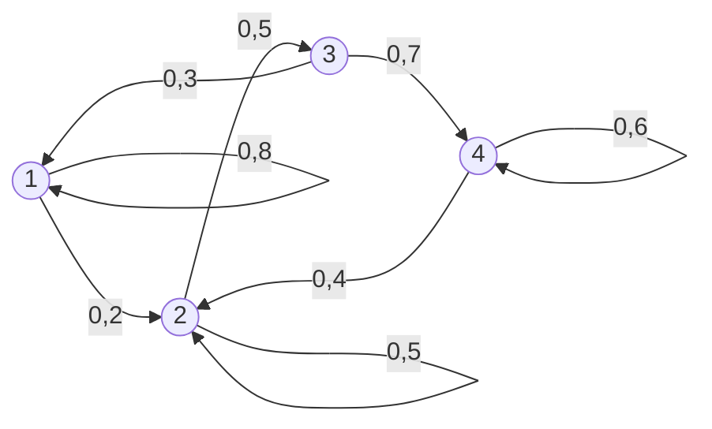

# Цепи Маркова с дискретным временем

Лекция 15.09.2026, первая пара (11:50). Начало темы 3 «Моделирование марковских процессов», после [фиктивных переменных](04-fiktivnye-peremennye-i-otbor-regressorov.md). Продолжение — [вторая пара того же дня](06-ergodichnost-pagerank-uravneniya-kolmogorova.md).

## Кратко

- Марковские процессы классифицируются по двум осям: время дискретное или непрерывное, состояния дискретные или непрерывные. В курсе изучаются два типа с дискретными состояниями. С дискретным временем начинаем сейчас, с непрерывным — основа систем массового обслуживания (СМО).
- **Цепь Маркова** — процесс без памяти: вероятность следующего состояния зависит только от текущего и не зависит от истории. Звено цепи сцеплено только с соседним.
- Цепь удобно задавать **графом состояний и переходов (ГСП)**, но при десятках состояний граф нечитаем. Тогда используют **матрицу перехода** $\mathbf{P}_1$: в каждой строке сумма равна 1.
- Матрица перехода за $n$ шагов однородной цепи — степень матрицы за один шаг: $\mathbf{P}_n = \mathbf{P}_1^n$. Это следует из **равенства Маркова** (формулы полной вероятности).
- Состояние системы описывается вектором-строкой вероятностей $\mathbf{q}$. Прогноз на $n$ шагов: $\mathbf{q}_n = \mathbf{q}_0 \mathbf{P}_n$, порядок множителей менять нельзя.
- С ростом $n$ матрица $\mathbf{P}_n$ стабилизируется, и распределение по состояниям перестаёт зависеть от начального. Это **стационарное распределение**: его вероятности означают долю времени, которую система проводит в каждом состоянии.

## Типы случайных процессов

**Случайный процесс** протекает в системе, если её состояние меняется со временем случайным, непредсказуемым образом.

- **Процесс с дискретными состояниями:** состояния $S_1, S_2, S_3, \dots$ можно пронумеровать, а переход между ними происходит скачком, мгновенно.
- **Процесс с дискретным временем:** переходы возможны только в строго определённые моменты. Между ними состояние гарантированно не меняется.
- **Процесс с непрерывным временем:** переход возможен в любой наперёд неизвестный, случайный момент.

| Время \ Состояния | Дискретные | Непрерывные |
|---|---|---|
| **Дискретное** | Подбрасывание монеты: в моменты 0, 1, 2… значение 0 или 1. **Изучаем сейчас** | Среднесуточная температура: любое значение, но в фиксированные моменты. Так устроена дискретизация речи и видео в цифровых каналах. Не изучаем |
| **Непрерывное** | Длина очереди: 0, 1, 2…, меняется в случайные моменты. **Изучаем далее, основа СМО** | Цена акции, лента метеорологического самописца. Не изучаем |

Нижнюю правую клетку лектор рекомендует изучить самостоятельно, когда появится опыт. В информационных системах такие процессы встречаются редко: там почти всегда дискретизация.

### Нумерация состояний

Состояния нумеруют с 1 или с 0, как удобнее. Для объяснений — с единицы. В СМО — с нуля, потому что состояние там означает число занятых (или свободных) каналов, и «ни одного» естественно обозначить $S_0$. Терминология СМО будет на следующей неделе.

## Цепь Маркова

**Цепь Маркова** — последовательность испытаний, в каждом из которых система принимает только одно из $k$ состояний **полной группы**. При этом условная вероятность $p_{ij}(s)$ того, что в $s$-м испытании система окажется в состоянии $j$, если после $(s-1)$-го она была в состоянии $i$, не зависит от результатов более ранних испытаний.

Разбор обозначений:

- **Полная группа состояний** — тот же смысл, что полная группа событий в теории вероятностей. Других состояний нет, и в одном из них система находится наверняка. Пример: в системе с тремя каналами обслуживания полная группа — заняты 0, 1, 2 или 3 канала.
- $i$ — откуда переходим, $j$ — куда. $p_{35}$ — вероятность перехода из третьего состояния в пятое.
- $s$ — номер испытания, дискретный аналог времени. Вероятности могут зависеть от $s$: система стареет или развивается, и вероятность перехода $1 \to 3$ в начале работы может отличаться от вероятности в конце.

**Почему «цепь».** Состояние 10 зависит только от 9-го, 9-е — только от 8-го. От 8-го десятое напрямую не зависит, лишь через 9-е. Так же звено цепи сцеплено только с соседним.

| Вид цепи | Когда меняются состояния |
|---|---|
| **С дискретным временем** | В определённые фиксированные моменты |
| **С непрерывным временем** | В любые случайные моменты |

## Граф состояний и переходов и матрица перехода

**Граф состояний и переходов (ГСП)**: вершины — состояния $S_i$, направленные дуги — возможные переходы с вероятностями $p_{ij}$. Нет стрелки — переход невозможен. Связь может быть односторонней: в примере ниже из $S_3$ в $S_1$ перейти можно, обратно — нет.

Пример ГСП со слайдов:



Та же цепь в виде матрицы перехода (строка — откуда, столбец — куда):

| Из \ В | 1 | 2 | 3 | 4 |
|---|---|---|---|---|
| **1** | 0,8 | 0,2 | — | — |
| **2** | — | 0,5 | 0,5 | — |
| **3** | 0,3 | — | — | 0,7 |
| **4** | — | 0,4 | — | 0,6 |

Из состояния 3 система остаться в нём не может: уходит в 1 (0,3) или в 4 (0,7).

Зачем матрица вместо графа:

1. Граф хорош при нескольких состояниях. При 30 состояниях каждое теоретически связано с каждым: стрелок сотни, на экране их не разместить.
2. Матрица — настоящий математический объект: её можно умножать и вообще производить вычисления, с графом так нельзя.

> [!TIP]
> При показе матрицы нули не пишут: глаз воспринимает заполненную ячейку как значимую, и читаемость падает. При вычислениях пустые клетки обязательно заполняются нулями. Петли-переходы «в себя» на графе часто не рисуют, чтобы не загромождать чертёж.

### Однородная цепь

**Однородная цепь Маркова** — вероятность $p_{ij}(s)$ не зависит от номера испытания $s$: со временем ничего не меняется. Тогда пишут просто $p_{ij}$.

**Матрица перехода** однородной цепи с $k$ состояниями:

$$\mathbf{P}_1 = \begin{pmatrix} p_{11} & p_{12} & \cdots & p_{1k} \\ p_{21} & p_{22} & \cdots & p_{2k} \\ \cdots & \cdots & \cdots & \cdots \\ p_{k1} & p_{k2} & \cdots & p_{kk} \end{pmatrix}$$

Первый индекс — номер строки (предшествующее состояние), второй — столбца (последующее). Это договорённость линейной алгебры со времён её зарождения.

$$\sum_{j=1}^{k} p_{ij} = 1, \quad i = 1, 2, \dots, k$$

Строка — вероятности переходов из одного и того же состояния $i$ во все возможные, включая само $i$. Они образуют полную группу, поэтому их сумма равна единице. Каждый элемент лежит в $[0; 1]$.

> [!NOTE]
> Соглашения по оформлению формул, о которых напомнил лектор: переменные — курсивом, цифры — всегда прямым шрифтом; греческие буквы традиционно прямые (сейчас правило часто нарушают); матрицы и векторы — прямые полужирные заглавные ($\mathbf{P}$, $\mathbf{q}$). На доске вместо полужирного ставят знак над буквой. Правило возникло, чтобы читатель-иностранец отличал символы формулы от текста.

## Равенство Маркова: переходы за n шагов

$P_{ij}(n)$ — вероятность перейти из $i$ в $j$ ровно за $n$ шагов (заглавная курсивная $P$, чтобы не путать с $p_{ij}(s)$). Например, $P_{25}(10)$ — из второго состояния в пятое за 10 шагов. Путь может быть любым: $3 \to 5$ напрямую или $3 \to 1 \to 8 \to 9 \to 5$.

Зачем: каждый шаг — единица времени, поэтому $P_{ij}(n)$ — это **прогноз** состояния системы на $n$ тактов вперёд. При $n = 1$ получаем обычные переходные вероятности: $P_{ij}(1) = p_{ij}$.

**Задача:** зная $p_{ij}$, найти $P_{ij}(n)$. Приём Маркова — ввести промежуточное состояние $r$: за $m$ шагов система переходит из $i$ в $r$, за оставшиеся $n - m$ шагов — из $r$ в $j$. На первый взгляд задача усложняется, но по формуле полной вероятности:

$$P_{ij}(n) = \sum_{r=1}^{k} P_{ir}(m)\, P_{rj}(n-m)$$

Это **равенство Маркова**: вероятность попасть из $i$ в $j$ за $n$ шагов — сумма по всем промежуточным $r$ произведений «дойти до $r$» на «дойти от $r$ до $j$».

При $n = 2$ промежуточный шаг может быть только $m = 1$:

$$P_{ij}(2) = \sum_{r=1}^{k} p_{ir}\, p_{rj}$$

Это в точности формула элемента произведения матриц: строка $i$ матрицы $\mathbf{P}_1$, умноженная на столбец $j$. Отсюда:

$$\mathbf{P}_2 = \mathbf{P}_1 \mathbf{P}_1 = \mathbf{P}_1^2, \quad \mathbf{P}_3 = \mathbf{P}_2 \mathbf{P}_1 = \mathbf{P}_1^3, \quad \dots, \quad \mathbf{P}_n = \mathbf{P}_1^n$$

**Неоднородная цепь** усложняет запись, но не вычисления. Матрицы всё так же перемножаются $n$ раз, только разные:

$$\mathbf{P}_n = \mathbf{P}_1(1)\, \mathbf{P}_1(2) \cdots \mathbf{P}_1(n)$$

Перемножать слева направо, в порядке шагов: сначала переход первого момента, потом второго и так далее.

## Вектор состояния и прогноз

Самое полное описание состояния системы — вероятности нахождения в каждом из состояний:

$$\mathbf{q}_0 = (p_1, p_2, \dots, p_n), \quad \sum p_i = 1$$

$p_1$ — вероятность, что система сейчас (в начальный момент) в состоянии 1, и так далее. Где именно система, знать не обязательно: «10 % — в первом, 90 % — во втором». Если состояние известно точно (например, мы сами привели систему во второе), то $\mathbf{q}_0 = (0, 1, 0, \dots, 0)$. Единица в сумме обязательна — либо сосредоточенная в одном состоянии, либо «размазанная» по нескольким.

Состояние через $n$ шагов:

$$\mathbf{q}_n = \mathbf{q}_0 \mathbf{P}_n$$

> [!IMPORTANT]
> $\mathbf{q}_0$ — **вектор-строка**, и стоит он **слева** от матрицы. Записать его столбцом и поставить справа нельзя: получатся другие числа. Формула верна и для однородных, и для неоднородных цепей — по-разному вычисляется только $\mathbf{P}_n$.

## Пример 1: погода

Задача из тренировочных заданий ЕГЭ (там прогноз через два дня, а не на послезавтра). Школьнику не стоит говорить, что это цепь Маркова — иначе он откажется решать.

Погода бывает отличной (О) или хорошей (Х). Если сегодня отличная, завтра будет отличной с вероятностью 0,8 и хорошей с 0,2. Если хорошая — 0,5 и 0,5. Сегодня отличная. Найти вероятности отличной и хорошей погоды послезавтра.

Это цепь Маркова: погода завтра зависит только от погоды сегодня. Цепь однородна — переходные вероятности одинаковы на каждом шаге. В неоднородной картинка осталась бы той же, но на втором шаге стояли бы другие числа, например 0,7/0,3 и 0,4/0,6.

$$\mathbf{q}_0 = (1;\ 0), \quad \mathbf{P}_1 = \begin{pmatrix} 0{,}8 & 0{,}2 \\ 0{,}5 & 0{,}5 \end{pmatrix}$$

Первое состояние — отличная погода, второе — хорошая. Погода сегодня известна точно, поэтому вектор $(1;\ 0)$.

### Решение деревом (школьный способ)

```text
день 0:            О
                 /   \
              0,8     0,2
день 1:        О       Х
              / \     / \
           0,8  0,2 0,5  0,5
день 2:     О    Х   О    Х
          0,64 0,16 0,10 0,10
```

Последовательные переходы («и») — умножаем, альтернативные пути («или») — складываем:

- $P(\text{О}) = 0{,}8 \cdot 0{,}8 + 0{,}2 \cdot 0{,}5 = 0{,}64 + 0{,}10 = 0{,}74$;
- $P(\text{Х}) = 0{,}8 \cdot 0{,}2 + 0{,}2 \cdot 0{,}5 = 0{,}16 + 0{,}10 = 0{,}26$.

Проверка: $0{,}74 + 0{,}26 = 1$. Сумма, равная единице, не гарантирует отсутствия ошибок: по шутке лектора, правильный ответ может означать чётное число ошибок. Но если сумма не равна единице, ошибка точно есть.

### Решение матрицей

$$\mathbf{P}_2 = \begin{pmatrix} 0{,}8 & 0{,}2 \\ 0{,}5 & 0{,}5 \end{pmatrix}^2 = \begin{pmatrix} 0{,}8 \cdot 0{,}8 + 0{,}2 \cdot 0{,}5 & 0{,}8 \cdot 0{,}2 + 0{,}2 \cdot 0{,}5 \\ 0{,}5 \cdot 0{,}8 + 0{,}5 \cdot 0{,}5 & 0{,}5 \cdot 0{,}2 + 0{,}5 \cdot 0{,}5 \end{pmatrix} = \begin{pmatrix} 0{,}74 & 0{,}26 \\ 0{,}65 & 0{,}35 \end{pmatrix}$$

- Первая строка — те же 0,74 и 0,26: дерево рисовать не нужно, достаточно возвести матрицу в квадрат.
- Вторая строка заодно отвечает на вопрос «а если сегодня хорошая погода»: послезавтра отличная с вероятностью 0,65, хорошая — 0,35.

### Стабилизация матрицы

| $n$ | Строка «сегодня О» | Строка «сегодня Х» |
|---|---|---|
| 1 | 0,800 / 0,200 | 0,500 / 0,500 |
| 2 | 0,740 / 0,260 | 0,650 / 0,350 |
| 3 | 0,722 / 0,278 | 0,695 / 0,305 |
| 4 | 0,717 / 0,283 | 0,709 / 0,292 |
| 5 | 0,715 / 0,285 | 0,713 / 0,287 |
| 6 | 0,714 / 0,286 | 0,714 / 0,286 |

$\mathbf{P}_3$ — ответ исходной задачи ЕГЭ (через два дня).

Что видно:

- От $\mathbf{P}_1$ к $\mathbf{P}_2$ меняются даже первые значащие цифры. Затем элементы стабилизируются один за другим.
- $\mathbf{P}_6$ отличается от $\mathbf{P}_5$ не более чем на 0,001 в каждом элементе, а **строки становятся одинаковыми**: прогноз на далёкое будущее не зависит от сегодняшней погоды.
- Точного равновесия не будет никогда, как экспонента не касается асимптоты. С ростом $n$ стабилизируется всё больше знаков: при трёх знаках после запятой — к шестому шагу, при четырёх — примерно к десятому.

Для большинства практических задач трёх знаков «выше крыши». Но бывают задачи, где нужна точность до сотых или тысячных процента. Пример лектора: вероятность того, что для управления дронами свободно нужное число каналов связи.

Слайд с расчётом по векторам состояния для трёх начальных условий:

| Шаг | $\mathbf{q}_0 = (1;\ 0)$ | $\mathbf{q}_0 = (0;\ 1)$ | $\mathbf{q}_0 = (0{,}5;\ 0{,}5)$ |
|---|---|---|---|
| 0 | 1,0000 / 0,0000 | 0,0000 / 1,0000 | 0,5000 / 0,5000 |
| 1 | 0,8000 / 0,2000 | 0,5000 / 0,5000 | 0,6500 / 0,3500 |
| 2 | 0,7400 / 0,2600 | 0,6500 / 0,3500 | 0,6950 / 0,3050 |
| 3 | 0,7220 / 0,2780 | 0,6950 / 0,3050 | 0,7085 / 0,2915 |
| 10 и далее | 0,7143 / 0,2857 | 0,7143 / 0,2857 | 0,7143 / 0,2857 |

На графике три пары кривых, начавшись из разных точек, сливаются после пятого-шестого шага. Причина стационарности: следующее состояние получается умножением вектора на ту же матрицу перехода, но вектор при этом перестаёт меняться.

**Интерпретация.** Погода меняется случайно: стационарность не означает «отличная, потом хорошая» по расписанию. Но при заданной матрице переходов система 71 % времени проводит в состоянии «отлично» и 29 % — в «хорошо». Число дней в году с отличной погодой — $365 \cdot 0{,}71$, с хорошей — $365 \cdot 0{,}29$; точнее, $365 \cdot 5/7 \approx 261$ и $365 \cdot 2/7 \approx 104$.

Проверка вручную (метод разбирался на следующей паре): стационарный вектор $\boldsymbol{\pi} = (\pi_1;\ \pi_2)$ не меняется при умножении на матрицу, $\boldsymbol{\pi} = \boldsymbol{\pi}\mathbf{P}_1$. Первое уравнение: $\pi_1 = 0{,}8\pi_1 + 0{,}5\pi_2$, то есть $0{,}2\pi_1 = 0{,}5\pi_2$. С условием $\pi_1 + \pi_2 = 1$ получаем $\pi_1 = 5/7 \approx 0{,}7143$, $\pi_2 = 2/7 \approx 0{,}2857$.

> [!NOTE]
> Переход от «как состояние меняется со временем» к «доле времени в каждом состоянии» — ключевая идея, которая используется на следующей паре.

## Организационное

- В курсе 4 темы; 15.09 (обе пары) — только тема 3. У этой группы лекционных часов больше, чем у других групп лектора.
- Из литературы лектор рекомендует хотя бы посмотреть практикум по **GPSS** (Маликов, Усманова, «Практикум по дискретно-событийному моделированию сложных систем в среде ALINA GPSS») — «реально очень удобно моделировать».
- Слайды в вебинаре у части слушателей не переключались — презентацию стоит скачивать заранее и следить по номеру слайда (внизу слева).
- Совет для защиты ВКР: нумеруйте слайды. Комиссии проще попросить «слайд 6», чем перематывать вперёд-назад.
- Пример 2 (посетитель сайта) задан прочитать на перерыве, разбирался на следующей паре. Опоздавших лектор не ждёт.
- Про задания, сроки и экзамен на паре ничего не говорилось.

## Есть в слайдах, но не разбиралось

- Пример матрицы перехода для трёх состояний: $\mathbf{P}_1 = \begin{pmatrix} 0{,}5 & 0{,}2 & 0{,}3 \\ 0{,}4 & 0{,}5 & 0{,}1 \\ 0{,}6 & 0{,}3 & 0{,}1 \end{pmatrix}$.
- Пример 2 (посетитель сайта, состояния N, V, R), свойства цепей и стационарное распределение — разобраны на [второй паре](06-ergodichnost-pagerank-uravneniya-kolmogorova.md).

## Термины

| Термин | Значение |
|---|---|
| Случайный процесс | Случайное, непредсказуемое изменение состояния системы во времени |
| Процесс с дискретными состояниями | Состояния можно пронумеровать, переход между ними мгновенный, скачком |
| Процесс с дискретным временем | Переходы только в фиксированные моменты, между ними состояние неизменно |
| Процесс с непрерывным временем | Переход возможен в любой случайный момент |
| Цепь Маркова | Последовательность испытаний, где вероятность следующего состояния зависит только от текущего |
| Полная группа состояний | Перечень всех возможных состояний; система наверняка в одном из них |
| ГСП | Граф состояний и переходов: вершины — состояния, дуги — переходы с вероятностями $p_{ij}$ |
| Переходная вероятность $p_{ij}$ | Вероятность перейти из состояния $i$ в состояние $j$ за один шаг |
| Матрица перехода $\mathbf{P}_1$ | Матрица всех $p_{ij}$; сумма каждой строки равна 1 |
| Однородная цепь | Переходные вероятности не зависят от номера шага |
| Равенство Маркова | $P_{ij}(n) = \sum_r P_{ir}(m) P_{rj}(n-m)$; отсюда $\mathbf{P}_n = \mathbf{P}_1^n$ |
| Вектор состояния $\mathbf{q}$ | Вектор-строка вероятностей нахождения системы в каждом состоянии |
| Стационарное распределение | Вектор состояния, который не меняется при умножении на матрицу перехода |
