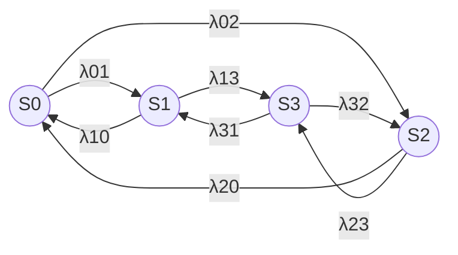
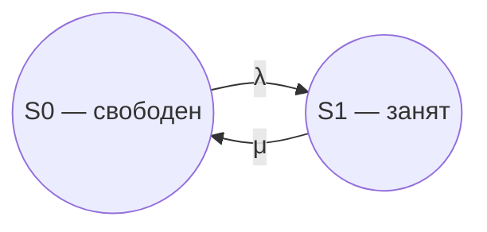

# Эргодичность, PageRank и уравнения Колмогорова

Лекция 15.09.2026, вторая пара (13:50). Продолжение [первой пары](05-cepi-markova-diskretnoe-vremya.md) по теме 3 «Моделирование марковских процессов»: стационарное распределение, свойства цепей, PageRank, переход к непрерывному времени.

## Кратко

- **Стационарное распределение** находится без пошагового расчёта: решить систему $\boldsymbol{\pi} = \boldsymbol{\pi}\mathbf{P}_1$, заменив одно уравнение условием нормировки $\sum \pi_i = 1$.
- Свойства цепей (неразложимость, периодичность, возвратность) нужны прежде всего ради **эргодичности**. Эргодическая цепь — неразложимая и нециклическая. Её стационарные вероятности существуют и не зависят от начального состояния.
- **Эргодическая теорема:** на бесконечно длинной траектории среднее по времени равно среднему по пространству. Доля времени, которую один объект проводит в состоянии, равна доле объектов, находящихся в нём в любой момент.
- **PageRank** — прямое коммерческое применение: случайное блуждание по ссылкам задаёт цепь Маркова, стационарные вероятности страниц ранжируют их по посещаемости.
- В непрерывном времени вероятность перехода в заданный момент равна нулю. Поэтому вместо вероятностей переходов используют **интенсивности потоков событий** $\lambda_{ij}$.
- **Уравнения Колмогорова** — баланс «притоков» и «оттоков» вероятности для каждого состояния. В стационарном режиме производные равны нулю, и система становится линейной алгебраической.

## Пример 2: посетитель сайта

Ежедневное поведение вымышленного читателя сайта. Пространство состояний $\mathbf{E} = \{N, V, R\}$:

| Состояние | Смысл |
|---|---|
| $N$ | не заходил на сайт |
| $V$ | зашёл, но не читал пост |
| $R$ | зашёл и прочитал пост целиком |

В первый день читатель с вероятностью 0,5 только заходит и с вероятностью 0,5 заходит и читает:

$$\mathbf{q}_0 = (0{,}0;\ 0{,}5;\ 0{,}5)$$

Переходы день-к-дню (строки и столбцы в порядке $N, V, R$):

$$\mathbf{P}_1 = \begin{pmatrix} 0{,}25 & 0{,}50 & 0{,}25 \\ 0{,}00 & 0{,}50 & 0{,}50 \\ 0{,}33 & 0{,}33 & 0{,}34 \end{pmatrix}$$

- Не заходил вчера → сегодня снова не зайдёт с вероятностью 0,25, только зайдёт — 0,5, зайдёт и прочитает — 0,25.
- Зашёл без чтения → не зайдёт 0, зайдёт без чтения 0,5, прочитает 0,5.
- Прочитал → 0,33 / 0,33 / 0,34.

Задача та же, что с погодой, но с тремя состояниями — матрица $3 \times 3$.

> [!NOTE]
> На слайде матрица обозначена строчной курсивной $p$. Лектор отметил, что это ошибка оформления: матрица — прямая полужирная $\mathbf{P}$.

Распределение на следующий день:

$$\mathbf{q}_1 = \mathbf{q}_0 \mathbf{P}_1 = (0{,}165;\ 0{,}415;\ 0{,}420)$$

Например, $q_N = 0 \cdot 0{,}25 + 0{,}5 \cdot 0{,}00 + 0{,}5 \cdot 0{,}33 = 0{,}165$.

## Стационарное распределение напрямую

Вместо того чтобы протягивать расчёт по дням (в Excel он тоже сойдётся к шестому-восьмому дню при любом начальном состоянии), сразу ищем вектор, который не меняется при умножении на матрицу:

$$(p_N\ \ p_V\ \ p_R) = (p_N\ \ p_V\ \ p_R)\, \mathbf{P}_1$$

Это задача на **собственный вектор** матрицы $\mathbf{P}_1$ с собственным значением 1.

Общий вид системы для финальных вероятностей ($n \to \infty$):

$$\begin{cases} \pi_1 = p_{11}\pi_1 + p_{21}\pi_2 + \dots + p_{n1}\pi_n \\ \pi_2 = p_{12}\pi_1 + p_{22}\pi_2 + \dots + p_{n2}\pi_n \\ \dots \\ \pi_n = p_{1n}\pi_1 + p_{2n}\pi_2 + \dots + p_{nn}\pi_n \\ \pi_1 + \pi_2 + \dots + \pi_n = 1 \end{cases}$$

В уравнении для $\pi_j$ стоит **столбец** $j$ матрицы: в $j$ приходят из всех состояний. Уравнения баланса линейно зависимы, поэтому одно из них вычёркивают и заменяют **условием нормировки**.

Расчёт для примера (третье уравнение вычеркнуто):

1. $\pi_N = 0{,}25\pi_N + 0{,}33\pi_R \Rightarrow \pi_N = 0{,}44\pi_R$.
2. $\pi_V = 0{,}5\pi_N + 0{,}5\pi_V + 0{,}33\pi_R \Rightarrow 0{,}5\pi_V = 0{,}22\pi_R + 0{,}33\pi_R \Rightarrow \pi_V = 1{,}1\pi_R$.
3. $(0{,}44 + 1{,}1 + 1)\pi_R = 1 \Rightarrow \pi_R = 1/2{,}54 \approx 0{,}39$.
4. $\pi_N \approx 0{,}17$, $\pi_V \approx 0{,}43$.

Смысл: 17 % дней читатель не заходит, 43 % — заходит без чтения (вместе 60 %), 39 % — заходит и читает. В сумме 99 % из-за округления.

## Свойства цепей Маркова

| Свойство | Определение | Пример со слайдов |
|---|---|---|
| **Неразложимость** | Из любого состояния можно достичь любого другого, не обязательно за один шаг. Граф неразложимой цепи **сильно связный** | Цепь 1 ⇄ 2 → 3 ⇄ 4 разложима на куски {1, 2} и {3, 4}: из 3 и 4 в 1 и 2 не вернуться. Добавили дугу 4 → 1 (0,2) — неразложима: пусть через сто лет, но переход 4 → 1 случится |
| **Поглощающее состояние** | Частный случай разложимой цепи: из вершины не выходит ни одна дуга. Необходимое условие: $p_{ii} = 1$ | Состояние $S_7$ с петлёй «в себя» |
| **Период** $k$ | Любой возврат в состояние занимает число шагов, кратное $k$; $k$ — НОД длин всех путей возврата. При $k = 1$ состояние **апериодическое**; цепь апериодическая, если апериодичны все состояния | Цепь из двух треугольников 1 → 2 → 3 → 1 и 1 → 4 → 5 → 1: возврат за 3 или 6 шагов, НОД = 3, все состояния периодичны с периодом 3 |
| **Невозвратность** | После ухода из состояния есть ненулевая вероятность в него не вернуться. **Возвратное** состояние — вернёмся с вероятностью 1 | Из 1 с вероятностью 0,5 уходим в пару 4 ⇄ 5 и застреваем там навсегда: 1 невозвратное, цепь разложима на {1, 2, 3} и {4, 5}. Добавили дугу 5 → 3 — невозвратных состояний нет |

В неразложимой цепи все состояния одного типа: если одно апериодическое, то и все остальные.

> [!TIP]
> Почему 2 — не период в треугольной цепи: уйдя из 1, за два шага окажемся в 3, а не в 1. Длину пути возврата считают «пальцем по графу»: число тактов от ухода из состояния до возвращения в него.

[?] Левую цепь на слайде с периодичностью (1 ⇄ 2 ⇄ 3 ⇄ 4, без петель) лектор описал невнятно — запись обрывается. По графу все пути возврата там чётной длины (2, 4, 6…), то есть период равен 2.

Зачем свойства по отдельности:

1. Знать терминологию.
2. Главное — подвести к **эргодичности**, ради неё все остальные свойства и рассматривались.

## Эргодичность

**Эргодической** называется **неразложимая и нециклическая** марковская система. Для неё можно определить **стационарные (финальные) вероятности** — вероятности состояний при числе шагов, стремящемся к бесконечности. Они **не зависят** от начального распределения.

Со слайдов: неразложимая цепь имеет стационарное распределение тогда и только тогда, когда одно из её состояний **положительно возвратное**.

**Эргодическая теорема:** когда траектория становится бесконечно длинной, **временное среднее равно пространственному** (взвешенному по стационарному распределению).

Пример лектора из физики газов:

1. Отслеживаем траекторию одной молекулы: в каких областях пространства она бывает и как часто.
2. По эргодической теореме: если молекула чаще проходит через какую-то область, то в любой момент там находится больше молекул.

Переход — от среднего по времени (одна молекула за бесконечно долгое время) к среднему по пространству (все молекулы в один момент). Свойство используется в астрономии, теории эволюции звёзд и в экономике, причём прямо в коммерции.

Эргодичность уже проявлялась: стационарные распределения в примерах с погодой и читателем сайта не зависели от начального состояния.

## PageRank

Алгоритм разработан Google для оценки посещаемости страниц. Чем выше посещаемость страницы, тем дороже на ней реклама.

**Модель.** Множество страниц уже отфильтровано, например по запросу. Пользователь в начальный момент находится на произвольной странице и перемещается **случайно**, щёлкая одну из ссылок на другие страницы множества. Ссылки наружу запрещены, все допустимые ссылки равновероятны.

- Страницы — состояния, ссылки — переходы, отсутствие памяти задаётся поведением пользователя.
- **Случайное блуждание:** у страницы с $K$ исходящими ссылками вероятность каждой равна $1/K$.

> [!WARNING]
> Случайные щелчки — сильное упрощение. Реальный человек некоторые ссылки не нажмёт никогда, а другие выбирает по своим предпочтениям. На паре разбиралась только **идея** алгоритма — сам алгоритм сложнее. По слайду, чтобы цепь была положительно возвратной и апериодической, в реальном алгоритме применяют «небольшие хитрости».

Граф семи страниц (ссылки → вероятности):

| Страница | Ссылки | Вероятность каждой |
|---|---|---|
| 1 | 2, 5, 6, 7 | 0,25 |
| 2 | 3, 4 | 0,5 |
| 3 | 2, 4 | 0,5 |
| 4 | 1, 7 | 0,5 |
| 5 | 1 | 1,0 |
| 6 | 7 | 1,0 |
| 7 | 1, 4 | 0,5 |

Это строки матрицы $\mathbf{P}_1$ размером $7 \times 7$ (на слайде нули заменены точками для наглядности, в расчёте — нули). Со страницы 5 ссылка одна, поэтому переход на 1 происходит с вероятностью 100 %, «совершенно случайно».

Цепь неразложимая и апериодическая, значит эргодическая, и стационарное распределение существует. Считается так же, как для погоды: пошагово в Excel или системой уравнений.

| Страница | 1 | 2 | 3 | 4 | 5 | 6 | 7 |
|---|---|---|---|---|---|---|---|
| PageRank | 28,57 % | 9,52 % | 4,76 % | 19,05 % | 7,14 % | 7,14 % | 23,81 % |
| Точно | 12/42 | 4/42 | 2/42 | 8/42 | 3/42 | 3/42 | 10/42 |

Строка «Точно» получена решением системы $\boldsymbol{\pi} = \boldsymbol{\pi}\mathbf{P}_1$ и совпадает с процентами слайда.

**Где здесь эргодическая теорема.** Каждый пользователь случайно блуждает и около 29 % времени проводит на странице 1. По эргодической теореме это значит, что в любой момент на странице 1 находится около 29 % всех посетителей. Самые посещаемые страницы — 1, 7, 4 (лектор назвал их в порядке 1, 4, 7). Там реклама дороже всего. Самая дешёвая реклама — на странице 3.

**Почему не логи?** Посещаемость можно посчитать по логам сервера скриптом. Но у нового, ещё не раскрученного сайта статистики нет, а раскрутка занимает несколько месяцев. Цены на рекламу при этом надо как-то обосновать — и модель даёт оценку по структуре ссылок и прогнозу вероятностей переходов.

## Марковские процессы с непрерывным временем

### Почему нужны потоки событий

Определение цепи для дискретного времени здесь непригодно: вероятность перехода в каждый наперёд заданный момент равна **точному нулю** (не бесконечно малой). При этом переходы всё же происходят.

Строгое решение даёт теория меры (мера и интеграл Лебега). На практике используют более простой подход Колмогорова: рассматривать не моменты, а интервалы времени, и говорить не о вероятностях переходов, а о **потоках событий**, которые переводят систему из состояния в состояние.

**Поток событий** — последовательность событий, наступающих в случайные моменты времени. Пример: звонки в скорую помощь.

Переход $S_i \to S_j$ происходит под воздействием потока с **интенсивностью** $\lambda_{ij}$. Например, $\lambda_{01}$ переводит систему из $S_0$ в $S_1$, $\lambda_{10}$ — обратно.

**Интенсивность потока** $\lambda$ — среднее число событий в единицу времени.

> [!IMPORTANT]
> $\lambda_{ij}$ — **не вероятность** перехода, а интенсивность, величина с размерностью «1/время».

Ключевой выбор — единица времени:

- небольшой морской порт: около 5 кораблей в **неделю**;
- АТС: около 20 вызовов в **секунду**;
- компьютерная система: единица может быть миллисекундой или микросекундой.

Единицу выбирают так, чтобы $\lambda$ была больше единицы, а лучше — целой: события целые, «одна стотысячная корабля в секунду» смысла не имеет. Это желательно, но не обязательно.

### Свойства простейшего потока

| Свойство | Формулировка со слайда | Смысл по лектору |
|---|---|---|
| **Стационарность** | Вероятность $k$ событий за промежуток зависит только от $k$ и длительности $t$, но не от начала отсчёта | Свойства потока не меняются со временем: в среднем 5 кораблей в неделю год за годом (в конкретную неделю может прийти 1 или 10) |
| **Отсутствие последействия** | Вероятность $k$ событий на промежутке не зависит от событий до его начала | Монета, выпавшая орлом 1000 раз подряд, на 1001-м броске всё так же даёт орла с вероятностью 1/2: она «не помнит» историю |
| **Ординарность** | Два и более события за малый промежуток практически невозможны | События приходят по одному |

«Малый промежуток» у лектора — много меньше единицы измерения времени, но больше времени обслуживания. Тогда обслуживание можно считать мгновенным, и заявки не пересекаются. [?] — в записи фрагмент частично неразборчив.

**Простейший (пуассоновский) поток** — поток, обладающий всеми тремя свойствами. «Простейший» — потому что свойства простые и упрощают работу с потоком.

**Формула Пуассона** — вероятность того, что за время $t$ наступит ровно $k$ событий простейшего потока с постоянной интенсивностью $\lambda$:

$$p_t(k) = \frac{(\lambda t)^k}{k!}\, e^{-\lambda t}$$

Слева — искомая вероятность, справа всё известно: $\lambda$, $t$, $k$. $\lambda t$ — среднее число событий за время $t$. Формула отражает все свойства простейшего потока; их несложно вывести из неё.

## Уравнения Колмогорова

Пример — система с четырьмя состояниями (на слайде — два узла, каждый исправен или нет; $S_0$ — оба исправны):

Состояния нумеруются с нуля. В любой момент система где-то находится (полная группа):

$$\sum_{i=0}^{3} p_i(t) = p_0(t) + p_1(t) + p_2(t) + p_3(t) = 1 \qquad (1)$$

Система дифференциальных уравнений Колмогорова:

$$\begin{cases} p_0' = \lambda_{10}p_1 + \lambda_{20}p_2 - (\lambda_{01} + \lambda_{02})p_0 \\ p_1' = \lambda_{01}p_0 + \lambda_{31}p_3 - (\lambda_{10} + \lambda_{13})p_1 \\ p_2' = \lambda_{02}p_0 + \lambda_{32}p_3 - (\lambda_{20} + \lambda_{23})p_2 \\ p_3' = \lambda_{13}p_1 + \lambda_{23}p_2 - (\lambda_{31} + \lambda_{32})p_3 \end{cases} \qquad (2)$$

**Как читать** (аналогия лектора с потоком жидкости; это мнемоника, а не физика):

- $p_i$ — «запас вероятности» в состоянии $S_i$.
- $p_i'$ — производная по времени, то есть **скорость изменения** запаса.
- Положительные слагаемые — **притоки**. $\lambda_{10}p_1$: запас из $S_1$ перетекает в $S_0$ с интенсивностью $\lambda_{10}$.
- Отрицательное слагаемое — **отток**: суммарная интенсивность всех выходящих потоков, умноженная на собственный запас.
- Баланс притоков и оттоков даёт скорость изменения. У $S_0$ два притока (из $S_1$, $S_2$) и два оттока (в $S_1$, $S_2$).

**Правило составления.** Слева — производная вероятности $i$-го состояния. Справа — сумма произведений вероятностей всех состояний, из которых стрелки идут в данное, на интенсивности этих потоков, минус суммарная интенсивность всех потоков, выводящих из данного состояния, умноженная на его вероятность.

**Проверка размерности.** Вероятности безразмерны (доли и проценты — тоже: размерность сокращается при делении). $p'$ — **не вероятность**, а изменение вероятности за единицу времени, размерность 1/с. $\lambda$ — «штук в секунду», то есть тоже 1/с. Обе части совпадают.

> [!IMPORTANT]
> Уравнения системы (2) линейно зависимы: независимых на одно меньше, чем всего. Любое одно уравнение вычёркивают — обычно последнее или самое громоздкое — и вместо него добавляют условие нормировки (1). Только тогда система имеет решение.

### Предельные (финальные) вероятности

В стационарном режиме вероятности не меняются, значит все производные равны нулю. Отрицательные слагаемые переносим влево и получаем линейную алгебраическую систему:

$$\begin{cases} (\lambda_{01} + \lambda_{02})p_0 = \lambda_{10}p_1 + \lambda_{20}p_2 \\ (\lambda_{10} + \lambda_{13})p_1 = \lambda_{01}p_0 + \lambda_{31}p_3 \\ (\lambda_{20} + \lambda_{23})p_2 = \lambda_{02}p_0 + \lambda_{32}p_3 \\ (\lambda_{31} + \lambda_{32})p_3 = \lambda_{13}p_1 + \lambda_{23}p_2 \end{cases} \qquad (3)$$

Её можно записать сразу по размеченному графу: «вероятность состояния × суммарная интенсивность выходящих потоков = сумма входящих потоков, умноженных на вероятности их источников». Сложив все уравнения, получим $0 = 0$: система опять линейно зависима. Одно уравнение заменяют на $p_0 + p_1 + p_2 + p_3 = 1$.

### Пример 1: одноканальная система с отказами

Один канал обслуживания. На него поступает простейший поток заявок с интенсивностью $\lambda$ (время между поступлениями распределено экспоненциально). Поток обслуживания — с интенсивностью $\mu$. Заявка, заставшая канал занятым, уходит.

Обозначения пришли из теории СМО:

- $\lambda$ — интенсивность «прямых» переходов, $\mu$ — «обратных». При нескольких переходах индекс показывает, откуда переход: $\lambda_0$, $\mu_1$.
- Это **процесс гибели и размножения**: $\lambda$ — интенсивность потока размножения, $\mu$ — гибели. Названия условны: что считать гибелью, а что размножением, зависит от задачи. Так же условно, какое состояние — свободный канал, а какое — занятый.

Вывод уравнений для этого примера на паре не разбирался — см. блок в конце.

## Организационное

- Из-за перегрузки ЛМС презентация по непрерывному времени у многих не открылась. Лектор вёл по локальному файлу; файл есть в материалах занятия — скачать.
- Переходить на сторонние платформы преподаватель не имеет права: это нарушение для него, кафедры и заведующего. Все занятия — только через ЛМС.
- Материал, который не успели (остаток темы 3), будет на следующих лекциях. Следующее занятие — через неделю.
- Про задания, сроки и экзамен на паре ничего не говорилось.

## Есть в слайдах, но не разбиралось

Начальные условия, матрица интенсивностей, решение примера 1

- **Начальные условия.** Для решения дифференциальных уравнений нужны вероятности в момент $t = 0$. Например, для системы (2) естественно $p_0(0) = 1$, $p_1(0) = p_2(0) = p_3(0) = 0$ (оба узла исправны).
- **Матрица интенсивностей** $\Lambda = (\lambda_{ij})$, $k \times k$: диагональные элементы неположительны ($\lambda_{ii} \le 0$), остальные неотрицательны ($\lambda_{ij} \ge 0$ при $i \ne j$). Сумма каждой строки равна нулю: $\sum_{j=1}^{k} \lambda_{ij} = 0$. Диагональ — минус суммарная интенсивность выхода из состояния. Пример: графу $S_1 \to S_2$ (1), $S_1 \to S_3$ (2), $S_2 \to S_3$ (2), $S_3 \to S_1$ (1) соответствует

  $$\Lambda = \begin{pmatrix} -3 & 1 & 2 \\ 0 & -2 & 2 \\ 1 & 0 & -1 \end{pmatrix}$$

- **Предельные (финальные) вероятности** — $p_i(t)$ при $t \to \infty$. Они постоянны, не зависят от начального состояния и равны среднему относительному времени пребывания системы в состоянии.
- **Пример 1, уравнения** при старте из $S_0$:

  $$P_0'(t) = -\lambda P_0(t) + \mu P_1(t), \quad P_1'(t) = -\mu P_1(t) + \lambda P_0(t), \quad P_0(0) = 1,\ P_1(0) = 0$$

- **Пример 1, решение** при $t \ge 0$:

  $$P_0(t) = \frac{\mu}{\lambda + \mu} + \frac{\lambda}{\lambda + \mu} e^{-(\lambda + \mu)t}, \quad P_1(t) = \frac{\lambda}{\lambda + \mu} - \frac{\lambda}{\lambda + \mu} e^{-(\lambda + \mu)t}$$

  При $t \to \infty$ экспоненты исчезают: $P_0 = \dfrac{\mu}{\lambda + \mu}$, $P_1 = \dfrac{\lambda}{\lambda + \mu}$. На графике $P_0(t)$ убывает от 1, а $P_1(t)$ растёт от 0, и обе кривые выходят на эти асимптоты.

Из плана темы 3 (презентация темы) пока не разбирались:

- аппроксимация потоков в системах теоретическими распределениями;
- общее описание процессов массового обслуживания;
- использование ИИ для генерации уравнений Колмогорова и их решения.

## Термины

| Термин | Значение |
|---|---|
| Стационарное (финальное) распределение | Вектор $\boldsymbol{\pi}$, для которого $\boldsymbol{\pi} = \boldsymbol{\pi}\mathbf{P}_1$, $\sum \pi_i = 1$ |
| Условие нормировки | $\sum \pi_i = 1$; заменяет одно из линейно зависимых уравнений баланса |
| Неразложимая цепь | Из любого состояния достижимо любое другое; граф сильно связный |
| Поглощающее состояние | Состояние, из которого нет выхода; $p_{ii} = 1$ |
| Период состояния | НОД длин всех путей возврата в состояние; при 1 — апериодическое |
| Невозвратное состояние | После ухода есть ненулевая вероятность никогда не вернуться |
| Эргодическая цепь | Неразложимая и нециклическая; финальные вероятности не зависят от начала |
| Эргодическая теорема | На бесконечной траектории среднее по времени равно среднему по пространству |
| PageRank | Ранжирование страниц по стационарному распределению случайного блуждания по ссылкам |
| Случайное блуждание | Переход по каждой из $K$ исходящих ссылок с вероятностью $1/K$ |
| Поток событий | Последовательность событий в случайные моменты времени |
| Интенсивность потока $\lambda$ | Среднее число событий в единицу времени |
| Простейший (пуассоновский) поток | Стационарный, без последействия, ординарный |
| Формула Пуассона | $p_t(k) = (\lambda t)^k e^{-\lambda t} / k!$ — вероятность $k$ событий за время $t$ |
| Уравнения Колмогорова | Дифференциальные уравнения баланса притоков и оттоков вероятности по состояниям |
| Процесс гибели и размножения | Цепь с прямыми переходами интенсивности $\lambda$ и обратными $\mu$ |
