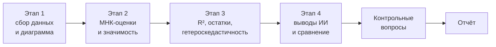

# Практикум 1. Регрессия цены квартиры на площадь — задание

Занятие 22.09.2026, первая пара (11:50). В расписании стоит как лекция, по РПД это первое практическое занятие по теме 1 «Классическая модель линейной парной регрессии». Теория темы — в конспектах [01](01-parnaya-linejnaya-regressiya.md)–[04](04-fiktivnye-peremennye-i-otbor-regressorov.md), вопросы по заданию разбирались на [второй паре](08-praktikum-1-voprosy-po-zadaniyu-i-sdache.md).

## Кратко

- Новой теории не было. Пара целиком посвящена заданию **ПРЗ1** («Практикум по решению задач», раздел «Практические занятия» в ЛМС): построить парную регрессию цены квартиры на общую площадь.
- Задание — небольшое настоящее исследование рынка квартир в российском городе, а не отработка кнопок. Больше всего времени уйдёт на сбор данных: минимум 30 квартир каждого типа (1-, 2- и 3-комнатные), то есть от 90 наблюдений.
- Модель строится только по **двухкомнатным** квартирам: $y$ — цена, $x$ — общая площадь. Строить её нужно и на исходных переменных, и на логарифмах: гетероскедастичность будет почти наверняка.
- Расчёт ведётся в **Excel** (инструмент «Регрессия»). На лабораторной по теме 1 те же данные будут обрабатываться на Python.
- **ИИ на этапе 4 разрешён официально**, но промпт нужно привести в отчёте и сравнить выводы ИИ со своими.
- Отчёт — один `.docx` с титульным листом (без него оценка снижается) плюс файл с данными `.xlsx` или `.csv`. Источники данных указываются ссылками на конкретные страницы.

## Почему практическое, а не лекция

- Группы разделили на потоки («распоточили»): вместо 10 групп на занятии только 101 и 102. Лекции шли потоком, практические идут по группам.
- Тема и литература те же, что на лекциях. Цель и задачи уточнены под практическое занятие.
- Недочитанный лекционный материал уходит на самостоятельное изучение. Перед каждым практическим и лабораторным лектор обещает давать нужную теорию.
- По теме 1 учебный план разбивает баллы на практическое и лабораторное: 5 за практическое и 5 за лабораторное вместо одной работы на 10 баллов.

Цель занятия по слайду: освоить построение и анализ классической модели парной регрессии — от МНК-оценок до проверки значимости и диагностики исходных предположений.

Задачи:

1. Сформулировать исходные предположения классической модели.
2. Оценить параметры методом наименьших квадратов.
3. Рассчитать стандартные ошибки коэффициентов.
4. Проверить значимость коэффициентов и построить доверительные интервалы.
5. Оценить качество уравнения через коэффициент детерминации и информационные критерии.

## Ход работы

### Этап 1. Подготовка данных и визуальный анализ

1. Собрать в интернете данные по стоимости жилых квартир в выбранном городе.
2. Построить выборку только из двухкомнатных квартир и диаграмму рассеяния: по вертикали цена, по горизонтали общая площадь. Визуально оценить, подходит ли линейная модель.
3. Прологарифмировать переменные (на слайде «при необходимости», см. ниже).

Набор переменных:

| Переменная | Роль / пояснение |
|---|---|
| Цена квартиры | зависимая переменная $y$ |
| Количество комнат | от 1 до 3 |
| Общая площадь | регрессор $x$ в этой работе |
| Жилая площадь | — |
| Этаж | — |
| Этажность дома | сколько этажей в доме: 5, 9, 16 и т. д. |
| Материал стен | — |
| Рынок | первичный или вторичный |

Требования к данным:

- **Город — российский**, любой: где живёте, где бывали, где нашлись данные. Зарубежный брать не стоит.
- **Не менее 30 наблюдений по каждому типу квартир** (однушки, двушки, трёшки), итого не меньше 90. Больше можно.
- **Студии** можно включить, но пометить как студию, а не однокомнатную. Реально они есть в основном в Москве и, возможно, в Петербурге.
- **4–5-комнатные не включать.** Их цена зависит от множества специфических факторов: парковка, охрана, огороженная территория и т. д. Квартиры от студии до трёшки более однородные и стандартные, анализировать их проще. Исследуется массовый, не премиальный и не элитный сегмент, в котором живёт больше 90 % населения.
- **Свежесть:** желательно не старше 2024 года, в крайнем случае 2023-й. С тех пор цены сильно ушли, в том числе после отмены льготной ипотеки.
- Готовые датасеты (например, с Kaggle) использовать можно.
- **Источники обязательны:** адрес конкретной страницы, а не сайта.

> [!NOTE]
> Однушки и трёшки в этой работе не участвуют в модели, но понадобятся на следующих занятиях (множественная регрессия). Собирать их нужно сразу.

> [!IMPORTANT]
> Слова «при необходимости прологарифмируйте» лектор попросил проигнорировать: необходимость есть заранее. Разброс цен будет расти с площадью, то есть появится выраженная **гетероскедастичность**, и самый простой способ с ней справиться — логарифмирование. Поэтому модель строится в двух вариантах: на исходных переменных и на логарифмах. Тот же эффект на московских данных разбирался в [лекции 3](03-multikollinearnost-diagnostika.md#практика-цены-квартир-в-москве-r).

### Этап 2. Оценка параметров МНК-модели

1. Оценить регрессию цены на общую площадь в MS Excel или другом табличном процессоре (на слайде опечатка «текстовый»). Нужен инструмент **«Регрессия»** из **«Анализа данных»**.
2. Выписать оценённое уравнение и построить линию регрессии на диаграмме рассеяния.
3. Указать экономический смысл коэффициентов (см. [лекцию 1](01-parnaya-linejnaya-regressiya.md#интерпретация-коэффициентов)).
4. Сформулировать нулевые гипотезы для модели в целом и для каждого коэффициента (см. [лекцию 3](03-multikollinearnost-diagnostika.md#проверка-гипотез-как-читать-p-value)).
5. Выписать стандартные ошибки коэффициентов, значения F- и t-статистик и прокомментировать их.
6. Если свободный член незначим — переоценить модель без него.
7. Построить доверительные интервалы для коэффициентов и сделать выводы.

Пункты 4–7 на паре не комментировались, но входят в задание.

> [!NOTE]
> **Справка (не из занятия) по русскому Excel.** «Анализ данных» появляется на вкладке «Данные» после подключения надстройки «Пакет анализа». В диалоге «Регрессия» есть флажки «Константа — ноль» (оценка без свободного члена, п. 6), «Уровень надёжности», «Остатки», «График нормальной вероятности» (этап 3). В выводе «Множественный R» — это коэффициент корреляции, а $R^2$ — строка «R-квадрат», скорректированный — «Нормированный R-квадрат». Лектор оговорился, что точных названий в Excel не помнит.

### Этап 3. Оценка качества модели

1. Рассчитать $R^2$ и $R^2_{adj}$ и объяснить, чем они различаются. Разница — в [лекции 1](01-parnaya-linejnaya-regressiya.md#практика-r-и-вывод-summary): скорректированный штрафует за каждый лишний регрессор. Ответ лектор советует поискать и в интернете.
2. Визуально оценить нормальность распределения остатков по графику нормального распределения. Это флажок внутри того же инструмента «Регрессия».
3. Визуально оценить гетероскедастичность для обеих моделей (исходные переменные и логарифмы) и сделать вывод о пригодности моделей для прогнозирования.

Как смотреть гетероскедастичность «на глаз»: упорядочить данные по возрастанию площади и посмотреть, растёт ли размах цен.

> [!TIP]
> Здесь любой обоснованный вывод будет принят: оценка визуальная, и разные люди видят по-разному.

### Этап 4. Анализ с помощью ИИ-ассистента

На слайде этап по ошибке озаглавлен так же, как этап 2 («Оценка параметров МНК-модели»). По содержанию это диагностика регрессии с помощью ИИ.

1. Сформировать промпт: описание модели, коэффициенты, стандартные ошибки, $R^2$, описание графиков остатков.
2. Попросить ИИ:
    - интерпретировать результаты регрессии;
    - указать возможные нарушения предположений по описанию графиков;
    - предложить, как улучшить модель.
3. Сопоставить выводы ИИ с собственными выводами этапа 3 и зафиксировать, где они сходятся и где расходятся.

> [!IMPORTANT]
> ИИ на этом этапе разрешён явно: годится любой доступный чат (ChatGPT, DeepSeek, Алиса и т. п.). **Промпт обязательно привести в отчёте.** Порядок такой: сначала свои выводы, потом выводы ИИ, потом честное сравнение. ИИ, скорее всего, ответит подробнее — в этом и смысл сравнения.

### Контрольные вопросы

Ответы — часть работы. На паре вопросы не разбирались.

1. Сформулируйте все предпосылки классической линейной регрессии. Какая нужна для несмещённости, а какая — для эффективности оценок? (Условия — в [лекции 2](02-mnk-teorema-gaussa-markova.md#условия-гауссамаркова).)
2. В чём суть МНК? Почему минимизируется сумма квадратов, а не модулей остатков?
3. Что показывают стандартные ошибки коэффициентов и от чего они зависят?
4. Чем проверка значимости коэффициента отличается от построения доверительного интервала?
5. $R^2 = 0{,}9$. Значит ли это, что модель хорошая? Какие ещё показатели учесть?
6. В чём разница между AIC и BIC? Когда BIC предпочтительнее? (В лекциях курса пока не разбиралось.)
7. Что будет с МНК-оценками при нарушении гомоскедастичности? Как это обнаружить и исправить?
8. Можно ли использовать ИИ для диагностики регрессии? Сильные и слабые стороны по сравнению с классическими тестами.

## Отчёт

| Что | Требование |
|---|---|
| Титульный лист | обязателен, при отсутствии оценка снижается. Шаблон `.docx` лежит в ЛМС рядом с заданием |
| Основной файл | **один** `.docx` вместе с титульным листом: все вычисления из Excel, графики, пояснения, свои выводы, промпт и ответ ИИ |
| Оформление текста | Times New Roman 12 пт, выравнивание по ширине, «абзацный отступ 1.5 пт» (так на слайде; что имеется в виду — отступ или межстрочный интервал — не уточнялось [?]) |
| Второй (последний) файл | собранные данные в `.xlsx` или `.csv` |
| Источники данных | обязательно, адреса конкретных страниц. Список литературы не нужен |

> [!IMPORTANT]
> Почему титульный лист так важен: в прошлом году преподавателям сделали замечание за полные баллы работам без титульного листа. Параметры оформления (шрифт, выравнивание и т. п.) лектор тоже отдельно назвал важными.

## Организационное

- Файл задания можно скачать в вебинаре (iVA 360) или в ЛМС: личный кабинет → своя группа → «Практические занятия» → «Практикум по решению задач». Там же титульный лист. Искать в практических, а не в лабораторных.
- За одну пару работа не делается, за один день тоже. Сдавать 22.09 ничего не нужно.
- Сроки: расписание поменялось прямо перед парой. Лектор проверил: у групп 101 и 102 график не изменился, даты в ЛМС остаются прежними. Но расписание будет перекраиваться и дальше, даты могут сдвинуться.
- **Тесты:** их 4, по числу лабораторных. Тест по теме сдаётся на последнем лабораторном занятии темы, дата — в ЛМС. Лектор просит отвечать осознанно: сначала поработать с материалом и самому прочитать вопросы, а уже потом подключать ИИ.
- **Лабораторная по теме 1** — на тех же данных, на Python. Лектор рекомендует Google Colab, а не Jupyter: Colab открывает `.ipynb`, хотя и ругается на формат. Отчётом там будет сам файл блокнота, а не Word.

## Есть в слайдах, но не разбиралось

- Списки основной и дополнительной литературы (те же, что на лекциях): Афонин и Федосин «Моделирование систем», Воскобойников «Построение регрессионных эконометрических моделей (с примерами в Excel)», «Эконометрика в среде GRETL» и др. Ссылки — в презентации темы 1 на IPR SMART.
- Общая цель темы из презентации шире цели практического: сюда входят ещё выбор оптимальной модели и информационные критерии качества.

## Термины

| Термин | Значение |
|---|---|
| ПРЗ | практикум по решению задач — практическая работа в ЛМС |
| Распоточить | разделить поток групп на отдельные группы для практических занятий |
| Первичный / вторичный рынок | новостройки от застройщика / перепродажа жилья |
| Этажность дома | общее число этажей в доме, в отличие от этажа квартиры |
| $R^2_{adj}$ | скорректированный коэффициент детерминации со штрафом за число регрессоров |
| График нормального распределения остатков | график для визуальной проверки нормальности остатков: точки должны лечь близко к прямой |
