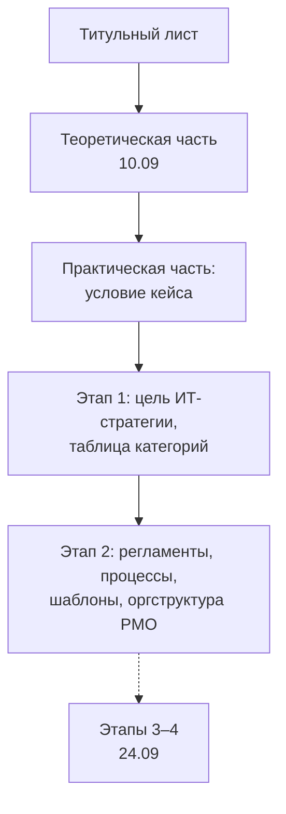

# Кейс «ТехноПрогресс»: проектирование проектного офиса

Занятие 17.09.2026, пара 13:50: второй день лабораторной работы 1, этап 2 практической части (слайд 11). Предыдущее — этап 1 и условие кейса в конспекте [03](03-kejs-tehnoprogress-it-strategiya.md); теория 10.09 — [01](01-organizaciya-raboty-i-teoreticheskaya-chast.md), [02](02-kriterii-uspeha-i-magicheskij-treugolnik.md).

## Кратко

- Этап 2 — спроектировать **проектный офис (PMO)** для «ТехноПрогресс» на **первой ступени зрелости**, чтобы убрать хаос в проектах, ролях, ресурсах, сроках и бюджетах.
- Задание 2.1 — **регламентная база**: ролевая модель, 2–3 ключевых процесса управления, минимум 3 шаблона документов, каждый описать подробно.
- Задание 2.2 — **оргструктура PMO**: кто возглавляет, кто в штате, кому подчиняется. Каждую роль и каждое подчинение — аргументировать.
- Этапы 1–2 — обязательный минимум на 17.09; этапы 3–4 — 24.09, после чего отчёт целиком прикрепляется в ЛМС.
- Литературы — **порядка 10 источников**; список оформляется по актуальному ГОСТу.

## Этап 2. Проектирование проектного офиса

Исходная ситуация: компания решила создать проектный офис, чтобы управлять проектами в рамках ИТ-стратегии из этапа 1 и координировать работу. Менеджмент не понимает, какие функции PMO должен выполнять. Ориентир для ответа — проблемы кейса из конспекта [03](03-kejs-tehnoprogress-it-strategiya.md#кейс-компания-технопрогресс): хаос в ролях, распределении ресурсов, соблюдении сроков и бюджетов.

### Задание 2.1. Регламентная база PMO на первой ступени зрелости

| Блок | Что требуется | Акцент преподавателя |
|---|---|---|
| Ролевая модель | Какие роли должны появиться и почему | Обосновать необходимость каждой роли |
| Процессы управления | Выбрать 2–3 ключевых процесса и описать их | Примеры: «Инициация проекта», «Планирование проекта», «Управление изменениями». Выбрать самые главные со своей точки зрения и рассмотреть подробно |
| Шаблоны документов | Минимум 3 шаблона, без которых работа руководителя проекта невозможна | Примеры: устав проекта, матрица ответственности, бизнес-план проекта. Объяснить, что это за документ и что он собой представляет |

Теория: состав регламентной базы на ступени I (принципы, ролевая модель, процессы, шаблоны), порядок разработки регламентов и минимальный набор документов на старте — лекция [02](../lectures/02-proektnyj-ofis-stupeni-zrelosti-1-3.md), раздел «Ступень I. Формирование»; функция регламентации — лекция [01](../lectures/01-informatizaciya-biznesa-proektnyj-ofis.md), «Ступень 1. Регламентация»; матрица ответственности — лекция [05](../lectures/05-it-proekty-stejkholdery-komanda-kommunikacii.md).

### Задание 2.2. Оргструктура PMO на этапе формирования

Ответить на три вопроса и аргументировать каждый:

1. Кто должен возглавить проектный офис?
2. Какие ключевые специалисты нужны в штате? На слайде в подсказке: директор, методолог, администратор.
3. Кому подчиняется проектный офис — генеральному директору, ИТ-директору или финансовому директору?

> [!IMPORTANT]
> Нужна не только схема, но и **иерархия соподчинения с учётом нового подразделения** в существующей функциональной структуре компании. Каждое подчинение и каждая роль — с аргументацией, почему именно так.

Теория: структура и квалификационные требования к сотрудникам PMO на ступени I — лекция [02](../lectures/02-proektnyj-ofis-stupeni-zrelosti-1-3.md), раздел «Регламентация деятельности самого проектного офиса»; виды и уровни проектных офисов — лекция [01](../lectures/01-informatizaciya-biznesa-proektnyj-ofis.md); сравнение функциональной, матричной и проектной структур — лекция [05](../lectures/05-it-proekty-stejkholdery-komanda-kommunikacii.md), раздел «Организационная структура проекта».

## Организационное

### Литература

- Одного-двух источников мало: только в первом вопросе теории нужно несколько определений из разных источников.
- Ориентир — **порядка 10 источников**, плюс-минус.
- Список литературы оформляется по последнему ГОСТу на оформление библиографии — номер на занятии не назывался, найти поиском «ГОСТ оформление списка литературы».

### Требования к оформлению

Отчёт оформляется по общим требованиям к научным работам:

- документ Word с титульным листом;
- Times New Roman;
- правильно оформленные поля (размеры на занятии не назывались);
- без ошибок;
- со списком литературы.

### Что пишется на титульном листе

Шаблон выдавался на первой паре (конспект [03](03-kejs-tehnoprogress-it-strategiya.md#титульный-лист)), состав стандартный:

- вверху — министерство и университет (федеральная «шапка»);
- кафедра, направление подготовки, группа;
- название дисциплины;
- «Лабораторная работа №…» с темой;
- студент (ФИО) и преподаватель;
- «Москва 2026».

Эмблема университета — желательно, но не обязательно.

## Что должно быть в отчёте после 17.09

- Теоретическая часть уже содержит элементы практики: таблицы по выбранному ИТ-проекту, магический треугольник, сценарии.
- Файл сохраняется у себя; 24.09 работа продолжается в нём же, после этапов 3–4 отчёт готов целиком и прикрепляется в ЛМС.

## Что дальше: этапы 3–4 (24.09)

На 17.09 не разбирались — только объявлены на следующее занятие.

| Этап | Задания | Теория |
|---|---|---|
| 3. Стратегическое управление (слайд 12) | Балансировка портфеля из трёх проектов (экологичные станки, модернизация станка, ПО удалённой диагностики) по матрице «привлекательность — рискованность»; что включить в портфель первым; роль портфельного комитета | лекция [03](../lectures/03-strategicheskoe-upravlenie-portfelem-proektov.md) |
| 4. Управление проектом «Внедрение ERP» (слайды 13–15; 50 млн руб., 18 мес.) | 4.1 классификация проекта и самые сложные этапы разработки; 4.2 матрица влияния и интересов (минимум 5 стейкхолдеров); 4.3 тип оргструктуры и фрагмент RACI на 4 задачи; 4.4 три ключевых риска, качественная оценка, стратегия реагирования | лекции [05](../lectures/05-it-proekty-stejkholdery-komanda-kommunikacii.md), [06](../lectures/06-bazovyj-plan-upravlenie-riskami.md) |

## Термины

| Термин | Значение |
|---|---|
| Проектный офис (PMO) | Подразделение, которое регламентирует проектную деятельность компании и координирует управление проектами |
| Регламентная база | Совокупность правил проектной деятельности: принципы, ролевая модель, процессы управления, шаблоны документов |
| Первая ступень зрелости PMO | Стадия формирования проектного офиса, ключевая функция — регламентация |
| Ролевая модель | Набор ролей в управлении проектами с границами полномочий, ответственности и порядком взаимодействия |
| Шаблон проектного документа | Готовая форма документа (устав проекта, матрица ответственности, бизнес-план), заполняемая по ходу проекта |
