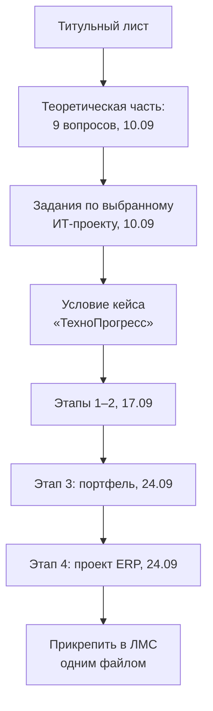

# Кейс «ТехноПрогресс»: управление проектом внедрения ERP

Занятие 24.09.2026, пара 13:50: заключительная часть лабораторной работы 1 — этап 4 (слайды 13–15). Сюда же сведены пояснения к этапу 4, которые преподаватель дала в начале пары 11:50. Предыдущее — этап 3 и требования к сдаче в конспекте [05](05-kejs-tehnoprogress-balansirovka-portfelya.md); условие кейса — в [03](03-kejs-tehnoprogress-it-strategiya.md#кейс-компания-технопрогресс).

## Кратко

- Этап 4 — спланировать управление стратегическим проектом **«Внедрение ERP-системы»**: бюджет 50 млн руб., срок 18 месяцев. Четыре блока: команда, стейкхолдеры, риски, коммуникации.
- 4.1 — классификация проекта и ответ, **какие этапы ИТ-разработки будут самыми сложными и почему**.
- 4.2 — матрица влияния и интересов (на слайде шесть стейкхолдеров — «чем больше, тем лучше»), для одного из правого верхнего квадрата — риск негативного поведения и план действий.
- 4.3 — выбор оргструктуры с **обоснованием** (подсказка: проектная выигрывает у матричной и тем более у функциональной) и фрагмент матрицы ответственности на 4 задачи.
- 4.4 — три ключевых риска с причиной и триггером, оценка вероятности и влияния, итоговый ранг (зелёный / жёлтый / красный), стратегия реагирования **для самого критического риска** с конкретными действиями.
- После этапа 4 отчёт готов целиком и прикрепляется в ЛМС одним файлом (подробности сдачи — в [05](05-kejs-tehnoprogress-balansirovka-portfelya.md#сдача-отчёта)).

## Этап 4. Управление ИТ-проектом «Внедрение ERP-системы»

Контекст: проектный офис «ТехноПрогресс» запускает стратегический проект по внедрению ERP-системы (**бюджет 50 млн руб., срок 18 мес.**). Задача — спланировать управление этим проектом. Задания идут по шагам, чтобы вопрос был проработан правильно.

### 4.1. Характеристика проекта

Дать характеристику по классификации:

- по бюджету и срокам — исходя из размера бюджета и длительности (полтора года);
- по функциональной области и задействованным подразделениям: сколько подразделений будет задействовано — одно (**монофункциональный**) или несколько (**кросс-функциональный**).

Затем — этапы ИТ-разработки (анализ, тестирование, интеграция, планирование, контроль — то, что разбиралось на лекции). Можно кратко сказать о каждом этапе, но главное — ответить, **какие этапы будут наиболее сложными именно для этого проекта и почему** вы так считаете (например, тестирование или анализ).

Теория: классификация проектов — лекция [04](../lectures/04-itsm-itil-osnovy-upravleniya-it-proektami.md#классификация-проектов) и задание 1 в конспекте [02](02-kriterii-uspeha-i-magicheskij-treugolnik.md#задание-1-классификация-проекта); этапы разработки ИТ-проекта — лекция [05](../lectures/05-it-proekty-stejkholdery-komanda-kommunikacii.md#этапы-разработки-ит-проекта).

### 4.2. Анализ стейкхолдеров: матрица влияния и интересов

Выделить **минимум 5** стейкхолдеров. На слайде их фактически шесть: гендиректор, финдиректор, начальник производства, ИТ-специалисты, конечные пользователи, внешний подрядчик. «Чем больше, тем лучше» — можно добавить своих.

Как строится матрица (разбор преподавателя; теория — лекция [05](../lectures/05-it-proekty-stejkholdery-komanda-kommunikacii.md#матрица-влияния-и-интересов)):

1. Вертикальная ось — **степень влияния** стейкхолдера на проект, от 0 (никак не влияет) до 10.
2. Горизонтальная ось — **интерес**, от 0 до 10. Высокий интерес — стейкхолдер сам зависит от проекта, для него это жизненно важно (не проект зависит от него, а наоборот).
3. Каждому стейкхолдеру выставить пару оценок и поставить его на пересечении.
4. Провести линии посередине обеих осей — поле делится на четыре квадрата.

Пример рассуждения с занятия: у гендиректора влияние максимальное — от его решений зависит многое, можно поставить 10. Интерес высокий, но не обязательно максимальный: у него несколько проектов, поэтому 8 или 9.

Стратегии по квадрантам (со слайда):

| Влияние \ Интерес | Низкий интерес | Высокий интерес |
|---|---|---|
| **Высокое влияние** | «Держите в курсе» | «Управляйте тщательно» |
| **Низкое влияние** | «Наблюдайте» | «Информируйте и консультируйте» |

На лекции [05](../lectures/05-it-proekty-stejkholdery-komanda-kommunikacii.md#матрица-влияния-и-интересов) те же квадранты назывались иначе: «активно вовлекать», «закрывать потребности», «оказывать внимание», «наименее важные».

Как читать результат (напоминание с пары 13:50): если почти все стейкхолдеры слева — у них низкий интерес, и встаёт вопрос, нужен ли проект, интересный только нам. Обратный перекос тоже требует проверки: возможно, кого-то не учли и оценка необъективна.

Шаблон для отчёта:

| Стейкхолдер | Влияние (0–10) | Интерес (0–10) | Квадрант и стратегия |
|---|---|---|---|
| Гендиректор | — | — | — |
| Финдиректор | — | — | — |
| Начальник производства | — | — | — |
| ИТ-специалисты | — | — | — |
| Конечные пользователи | — | — | — |
| Внешний подрядчик | — | — | — |

> [!IMPORTANT]
> Итоговый вопрос 4.2: для **одного** стейкхолдера из **правого верхнего** квадранта (высокое влияние и высокий интерес) описать **риск его негативного поведения** — как он может отрицательно повлиять на проект — и **план действий** по управлению им.

### 4.3. Оргструктура и матрица ответственности

Команда должна быть организована так, чтобы соблюсти сроки, качество, объём и бюджет. Для этого прорабатываются два вопроса.

**1. Тип оргструктуры** — функциональная, матричная или проектная. Не просто назвать, а **обосновать выбор**. Подсказка преподавателя: «если хорошо подумать», здесь наиболее целесообразна **проектная** структура — объяснить, почему она выигрывает у матричной и особенно у функциональной. Теория — лекция [05](../lectures/05-it-proekty-stejkholdery-komanda-kommunikacii.md#выбор-типа-оргструктуры) (таблица критериев выбора).

**2. Фрагмент матрицы ответственности (RACI)** на 4 задачи. По вертикали — задачи проекта, по горизонтали — роли; на пересечении буква: **У** — утверждает, **С** — согласует, **О** — ответственный, **И** — исполнитель. Пример логики: кто ставит задачу, кто утверждает техническое задание, кто исполняет.

| Задача | Спонсор (гендир) | Менеджер проекта | Бизнес-аналитик | Подрядчик (разработка) | Нач. цеха (пользователь) |
|---|---|---|---|---|---|
| Утверждение ТЗ | — | — | — | — | — |
| Разработка модуля «Производство» | — | — | — | — | — |
| Приёмочное тестирование | — | — | — | — | — |
| Обучение персонала | — | — | — | — | — |

- Не в каждой строке будут все буквы: где-то не будет «И», где-то «С».
- Задач может быть и больше, чем на слайде, можно добавить роль — «это ваш проект». Набор букв остаётся тот же: У, С, О, И.
- По лекции у каждой задачи — **один и только один ответственный** ([05](../lectures/05-it-proekty-stejkholdery-komanda-kommunikacii.md#матрица-ответственности)).

### 4.4. Управление рисками

Задание со слайда:

1. Идентифицировать **3 ключевых риска** проекта. Для каждого указать **причину** (что может спровоцировать риск) и **признак приближения — триггер** (по какому признаку будет видно, что риск приближается).
2. Провести **качественную оценку**: заполнить таблицу «вероятность / влияние / итоговый ранг».
3. Для **самого критического** риска выбрать стратегию реагирования (избежание / минимизация / передача / принятие) и описать **конкретные действия**.

Шаблон со слайда (первая строка — пример преподавателя):

| Риск | Причина | Триггер | Вероятность (выс / ср / низ) | Влияние (крит / выс / ср / низ) | Итоговый ранг |
|---|---|---|---|---|---|
| Пример: сопротивление сотрудников цеха | — | — | Высокая | Высокое | Красный |
| … | — | — | — | — | — |
| … | — | — | — | — | — |

На слайде в таблице только четыре столбца (риск, вероятность, влияние, ранг); причина и триггер требуются условием задания — их можно дать столбцами или текстом.

**Как получить итоговый ранг** (разбор с пары 13:50; теория — лекция [06](../lectures/06-bazovyj-plan-upravlenie-riskami.md#три-группы-рисков)). Риск — событие вероятностное: может произойти, а может нет. Поэтому у него две оценки:

- **вероятность** наступления — высокая, средняя, низкая;
- **влияние** — степень ущерба, если событие наступило: от «катастрофы», которая скажется на прибыли всего предприятия, до «что-то пострадало, идём дальше».

Две оценки сводятся в группу — в этом и состоит качественный смысл оценки: по группе понятно, какие нужны действия.

| Группа | Вероятность и влияние | Цвет в матрице | Ранг |
|---|---|---|---|
| 1 — умеренные | низкая вероятность, низкое влияние | зелёный | наименее критичный |
| 2 — значительные | высокая вероятность при низком влиянии **или** низкая вероятность при высоком влиянии | жёлтый | средний |
| 3 — критические | высокая вероятность и высокое влияние | красный | наиболее критичный: требует внимания и управления |

Отсюда «красный» в итоговом ранге примера. Вместо цвета можно ставить цифры 1, 2, 3 — какой риск считается наиболее критическим.

> [!IMPORTANT]
> Задача не только выявить и оценить риск, но и **выбрать конкретные действия** реагирования. Стратегия называется для самого критического риска из таблицы, и под неё расписываются действия. Стратегии и меры по каждой — лекция [06](../lectures/06-bazovyj-plan-upravlenie-riskami.md#стратегии-реагирования-на-риски).

## Итоговая структура отчёта по ЛП1

До конца пары 13:50 отводилось время на выполнение, чтобы не отставать от группы. Не успели — доделать как можно скорее и прикрепить.

## Термины

| Термин | Значение |
|---|---|
| ERP-система | Единая система планирования ресурсов предприятия — то, чего «ТехноПрогресс» не хватает по условию кейса |
| Монофункциональный / кросс-функциональный проект | Проект, задействующий одно подразделение / несколько подразделений |
| Матрица влияния и интересов | Поле «влияние (0–10) × интерес (0–10)», разделённое на четыре квадранта со своей стратегией работы со стейкхолдерами |
| Матрица ответственности (RACI) | Таблица «задачи × роли», где на пересечении буква У / С / О / И |
| Триггер риска | Признак приближения рискового события |
| Итоговый ранг риска | Группа риска по сочетанию вероятности и влияния: зелёный (умеренный), жёлтый (значительный), красный (критический) |
| Стратегия реагирования | Избежание, минимизация, передача или принятие риска с конкретными действиями |
