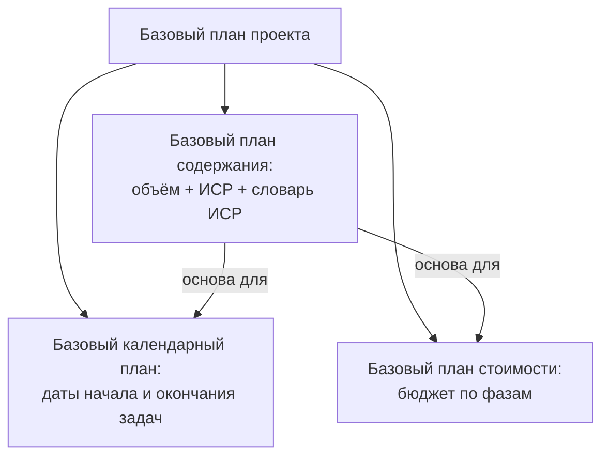

# Базовый план проекта и управление рисками

Лекция 11.09.2026, пара 13:50 (слайды 47–77): завершение темы 3 «Основы и методология управления ИТ-проектами. Команда ИТ-проекта». Предыдущая пара — конспект [05](05-it-proekty-stejkholdery-komanda-kommunikacii.md); практика по теме — лабораторная 1: [01](../labs/01-organizaciya-raboty-i-teoreticheskaya-chast.md), [02](../labs/02-kriterii-uspeha-i-magicheskij-treugolnik.md).

## Кратко

- **Базовый план проекта** — согласованные на планировании объём, сроки и стоимость; состоит из трёх базовых планов (содержания, календарного, стоимости), и по нему отслеживают прогресс.
- **Риск** характеризуется двумя величинами — вероятностью наступления и последствиями для проекта. Риск бывает и позитивным: неучтённое событие, дающее выгоду.
- Управление рисками — цикл из шести шагов: планирование → идентификация → качественный анализ → количественный анализ → планирование реагирования → мониторинг.
- Пять стратегий реагирования: передача, снижение, эскалация, уклонение, принятие (пассивное или активное).
- В начале проекта рисков больше всего, но потерять почти нечего; к концу рисков меньше, а цена ущерба выше. Поэтому риски анализируют многократно, а дешевле всего их минимизировать на планировании.
- Качественный анализ даёт **матрицу рисков** «вероятность × ущерб» с тремя зонами; количественный — точку безубыточности, анализ чувствительности, Монте-Карло, дерево решений.
- Управлять рисками имеет смысл только при частичной определённости: при полной неопределённости это невозможно, при полной определённости не нужно.

## Базовый план проекта

После оргструктуры и коммуникаций проект согласуют по объёму, срокам и стоимости. **Базовый план проекта** — сводные данные об объёме, сроках и стоимости, согласованные на этапе планирования. По нему в ходе выполнения отслеживают прогресс.



Зачем нужен:

- на старте — однозначно согласовать объём, стоимость и длительность со всеми заинтересованными лицами;
- в ходе проекта — контролировать выполнение по срокам, ресурсам и качеству.

Базовый план-график сохраняют и хранят его подписанную «твёрдую копию»: это утверждённый документ, по которому работают, а не набор цифр. Ход выполнения отслеживают диаграммой Ганта — на ней видны работы, исполнители и сроки.

### Три базовых плана

| План | Что это | Состав |
|---|---|---|
| **Содержания** | одобренная версия описания содержания, иерархическая структура работ (ИСР) и словарь ИСР | изложение содержания, основные поставляемые результаты, допущения и ограничения; основа двух других планов |
| **Календарный** (расписание) | особый вариант расписания, полученный анализом сети расписания; утверждается командой управления проектом с базовым стартом и базовым финишем | список и график работ; сроки — общие и по задачам; последовательность и зависимости задач |
| **Стоимости** | распределённый во времени суммарный исходящий денежный поток проекта для измерения и мониторинга исполнения стоимости | плановые (бюджетные) затраты на работы по расписанию |

**Словарь ИСР** — документ с подробной информацией о поставляемых результатах, операциях и расписании по каждому компоненту ИСР: идентификатор кода учёта, описание работ, допущения и ограничения, ответственная организация, контрольные события расписания.

Базовый календарный план нужен, чтобы выявлять отклонения фактических сроков от плановых.

Базовый план стоимости строят суммированием оценочных расходов по временным периодам: он показывает, сколько и когда предполагается потратить при заданном порядке работ. По нему формируют требования и условия финансирования — финансирование может идти поэтапно, по временной структуре бюджета.

## Риск: основные понятия

**Риск** — возможность воздействия на проект непредвиденных событий, которые могут нанести ущерб и помешать достижению целей. Качественная или количественная оценка такого влияния называется **степенью угрозы** и выражается через вероятность рискового события и влияние его последствий на результат.

При оценке рисков с катастрофическими последствиями учитывают три установленных компанией порога:

| Понятие | Определение |
|---|---|
| **Допустимая величина риска** (Risk Capacity) | максимальная сумма потерь, которую организация может выдержать, прежде чем цели проекта окажутся под вопросом |
| **Риск-аппетит** (Risk Appetite) | уровень отклонения от цели, который организация готова принять ради стратегических целей или других выгод |
| **Толерантность к риску** (Risk Tolerance) | границы принятия риска, которые проект может пережить без критических последствий для своих целей |

Две главные характеристики риска — **вероятность наступления** и **последствия воздействия**. На них строится матрица рисков и выбор способа управления.

Характеристики риска для описания: причина или источник, симптомы, последствия, влияние.

### Позитивные и негативные риски

Обычно риск понимают как отрицательное последствие: **степень опасности подвергнуться воздействию негативных событий**. Но в литературе встречается и другой взгляд: **возможности** — ожидаемые выгоды от позитивных случайных событий. Отсюда классификация по знаку влияния:

- **негативные риски** — отрицательно сказываются на проекте: штрафы за несоблюдение обязательств, срыв сроков;
- **позитивные риски** — неучтённые в плане события, которые положительно влияют на проект и дают заранее неизвестные возможности.

## Классификация рисков

**Классификация рисков** — распределение рисков по группам в зависимости от выбранного признака, исходя из направленности и специфики деятельности предприятия. Научно обоснованная классификация определяет место каждого риска в общей системе.

| Признак | Виды |
|---|---|
| Влияние события | **событийные** — связаны с наступлением события (в коде найдены ошибки, ведущие к потере данных; поставщик отказался от поддержки системы; изменились требования или стратегические цели заказчика);<br>**несобытийные** — без явного события: **риск вариативности** (отклонение от целевых ожиданий — производительность, ошибки — в большую или меньшую сторону) и **риск неоднозначности** (неопределённость будущих состояний и потребности в разрабатываемой функциональности: будет ли продукт востребован) |
| Уровень | **индивидуальный** — воздействие неопределённости на одну или несколько целей проекта; **совокупный** — на проект в целом |
| Понимание | **известные** — можно идентифицировать и оценить, спланировать реагирование и резервы; **неизвестные** — нельзя идентифицировать и спрогнозировать, реагирование не спланировать |
| Влияние на проект | негативные, позитивные |
| Объективность | **внешние** — связаны с внешней средой (за пределами предприятия); **внутренние** — с внутренними элементами: персонал, ресурсы, финансирование, техника |
| Контролируемость | неконтролируемые (не идентифицированы или нет мер реагирования), частично контролируемые, по большей части контролируемые |
| Уникальность | **общие факторы** — есть в любом проекте: дополнительные затраты, рост сроков, здоровье и безопасность;<br>**характерные для типов проектов** — инвестиционные (зависимость от внешнего инвестора), кредитные (изменение ставки);<br>**специфические** для конкретного проекта — брак, поломка оборудования |
| Функциональная область | технологические, юридические, маркетинговые, связанные с персоналом, связанные с безопасностью, корпоративные |

## Процесс управления рисками


| Процедура | Содержание |
|---|---|
| 1. Планирование управления рисками | выбор подходов и планирование деятельности по управлению рисками |
| 2. Идентификация | определение рисков, способных повлиять на проект, и документирование их характеристик |
| 3. Качественная оценка | анализ рисков и условий их возникновения для определения влияния на успех проекта |
| 4. Количественная оценка | численный анализ вероятности и влияния последствий |
| 5. Планирование реагирования | процедуры и методы ослабления негативных последствий и использования возможных преимуществ |
| 6. Мониторинг и контроль | отслеживание остающихся рисков, выполнение плана управления рисками, оценка эффективности мер |

**Управление рисками проекта** — процессы идентификации, анализа рисков и принятия решений, максимизирующих положительные и минимизирующих отрицательные последствия рисковых событий.

## Стратегии реагирования на риски

**Планирование реагирования на риски** — разработка вариантов, выбор стратегий и согласование действий по проанализированным рискам. Пять основных стратегий:

| Стратегия | Суть | Пример / замечание |
|---|---|---|
| **Передача** | негативные последствия и ответственность за реагирование переходят третьей стороне, обычно за премию; сам риск не устраняется | страхование: платим страховую премию, при наступлении страхового случая страховщик возмещает ущерб |
| **Снижение** | вероятность и/или последствия понижаются до приемлемых пределов; в план включают работы, выполняемые независимо от появления риска | дополнительное тестирование снижает вероятность поломки к серийному запуску |
| **Эскалация** | ответственность за риск передаётся на более высокий уровень управления организации | проект идёт внутри компании — решение за её руководством |
| **Уклонение** | план меняется так, чтобы полностью исключить рисковое событие, например отказом от части требований | вместе с риском теряется и возможный доход; оправдано, если расчёт показывает, что потери превысят выгоду |
| **Принятие** | **пассивное** — команда ничего не делает и ищет обход, когда риск наступит; **активное** — план действий в непредвиденных обстоятельствах готовится заранее | — |

Те же стратегии со стороны мер (слайд «Разработка методов управления рисками»; выходной документ — план управления рисками):

| Избежание | Уменьшение | Передача | Принятие |
|---|---|---|---|
| изменение плана проекта; отказ от ненадёжных партнёров; отказ от рискованных проектов | снижение вероятности и масштаба потерь; финансовые резервы, резервы времени и ресурсов; уменьшение объёма работ или требований | учёт риска в контрактах; деление риска с другими участниками или с другими программами и проектами; страхование | подготовка к «худшему»; план реагирования на последствия; выделение средств на устранение последствий |

Уменьшение и передачу на слайде объединяют в группу **минимизации**.

## Идентификация рисков

Цель — получить максимально полный **список рисков проекта** с описанием, причинами и условиями возникновения. Процесс итеративный и идёт весь жизненный цикл проекта.

### Инструменты идентификации

**Анализ участников проекта и их интересов** — четыре шага:

1. **Сбор информации** обо всех участниках и заинтересованных сторонах: интервью, опросы, анкетирование, если открытых источников мало. Учитывать явные и скрытые интересы.
2. **Классификация** — внутренние/внешние, важные/неважные: по категории стейкхолдера понятна логика реагирования на его действия.
3. **Оценка влияния и интересов** — по шкале «высокий / средний / низкий».
4. **Карта заинтересованных сторон** — визуализация влияния и интересов (подробно — в конспекте [05](05-it-proekty-stejkholdery-komanda-kommunikacii.md#карта-стейкхолдеров)).

**Ревизия документации** — комплексная проверка документов проекта на соответствие законодательным нормам и требованиям и на правильность составления.

**SWOT-анализ** — оценка сильных и слабых сторон проекта, его возможностей и угроз. Применим не только к проектам, но и к предприятиям, регионам, видам деятельности: быстро и системно раскладывает факторы по направленности и среде.

| Факторы | Позитивные | Негативные |
|---|---|---|
| **Внутренние факторы** | сильные стороны (S): например, собственное финансирование | слабые стороны (W): например, нет опыта подобных проектов |
| **Внешние факторы** | возможности (O): например, дешёвая рабочая сила | угрозы (T): например, закон, ограничивающий найм иностранных сотрудников |

**Экспертные оценки** — опрос специалистов в области проекта; отвечают на сложные вопросы о вероятности и размере ущерба, а заодно — о действенности мер предотвращения и минимизации. Эксперты бывают внешними (приглашены со стороны) и внутренними (работают в проекте). Методы: мозговой штурм, метод Дельфи, опросы, интервью.

**Анализ предположений и допущений** уточняет и риски, и список работ. Алгоритм:

1. Руководитель проекта генерирует гипотезы о целях, продуктах и задачах проекта.
2. Из гипотез отбирают допущения.
3. Допущения анализируют, ища пропущенные и неверные.
4. Каждое ставят под сомнение: «Что будет, если оно не оправдается?» (продукция не продастся в таком объёме; поставщик не привезёт столько сырья; кредит не дадут под этот процент) — так формируется список рисков.
5. По списку рисков ведут антирисковое планирование.

**Причинно-следственные диаграммы** — каждый риск изображается деревом: корневой узел — риск, ветви и листья — причины, факторы развития и возможные последствия.

Итог идентификации заносят в таблицу со столбцами: риск, категория и код, причины, признаки приближения, детальное описание.

## Качественный и количественный анализ

Цель — **проранжированный перечень рисков**: от наиболее к наименее важным. **Оценка рисков** — определение вероятности и последствий каждого риска; она помогает приоритизировать риски и выбрать подходящие методы управления.

| Критерий | Качественный анализ | Количественный анализ |
|---|---|---|
| Что даёт | вероятность риска и степень влияния; перечень потенциальных рискованных ситуаций | численная оценка вероятности и влияния; какие риски требуют больше внимания и мер |
| Методы | матрица рисков: оценка степени воздействия и вероятности | анализ предельного уровня; анализ чувствительности (what-if); имитационное моделирование, в т. ч. Монте-Карло; дерево решений |

### Динамика рисков по фазам проекта

На графике по горизонтали — фазы жизненного цикла: концепция, планирование, реализация, завершение. Две кривые:

- **количество рисков** — максимально в начале и снижается к концу: по ходу проекта прорабатываются меры реагирования;
- **влияние рисков** — минимально в начале и резко растёт к концу: в проект вложено всё больше времени, денег и ресурсов.

В начале вероятность угрозы максимальна, но потерь почти нет — в проект ещё ничего не вложено.

> [!IMPORTANT]
> Два вывода:
>
> 1. Риски анализируют **многократно** на протяжении проекта, а не один раз на старте; чем дальше проект, тем важнее контроль.
> 2. Дешевле всего риски минимизируются **на планировании** — многократно дешевле, чем на реализации. Чтобы сэкономить на непредвиденных потерях, придётся заранее потратиться на меры реагирования.

### Три группы рисков

Для оценки значимости риска определяют вероятность его возникновения и степень влияния на проект.

| Группа | Вероятность и влияние | Как с ней работать |
|---|---|---|
| I. Умеренные (низкий уровень) | низкая вероятность, некритичное влияние | — |
| II. Значительные (средний уровень) | высокая вероятность при низком влиянии или низкая вероятность при существенном влиянии | уже не умеренные, но ещё не критические |
| III. Критические (высокий уровень) | высокая вероятность и значительное влияние на проект и результат | привлекают внимание команды и становятся объектом управления |

> [!NOTE]
> В списке на слайде группы пронумерованы иначе: 1 — низкая/низкая, 2 — высокая/высокая, 3 — смешанная («средняя группа»). Номера в таблице выше взяты из легенды матрицы, где I — умеренные, II — значительные, III — критические.

Оценка субъективна: одна и та же опасность в разных проектах имеет разную вероятность и влияние.

### Матрица рисков

**Матрица оценки вероятности и последствий** — механизм определения негативного события через вероятность его наступления. Численно уровень риска — произведение вероятности на тяжесть вреда:

$$R = P \times S$$

$R$ — уровень риска, $P$ — вероятность наступления рискового события, $S$ — тяжесть последствий (размер ущерба). Произведение сводит обе характеристики в одну величину, по которой риски ранжируют.

По одной оси — уровни вероятности, по другой — уровни серьёзности последствий; какая ось вертикальная, не важно. На пересечении ставят номер группы или цвет: зелёный — I, жёлтый — II, красный — III. Пример со слайда:

| Вероятность \ Ущерб | Незначительный | Умеренный | Значительный | Высокий | Критический |
|---|---|---|---|---|---|
| Часто | II | II | III | III | III |
| Возможно | I | II | III | III | III |
| Маловероятно | I | II | II | III | III |
| Редко | I | I | II | II | III |
| Очень редко | I | I | I | II | II |

Матрица — ключевой компонент управления проектом: она визуализирует негативные моменты по убыванию серьёзности и показывает худший сценарий. Преимущества:

- всесторонний анализ разных ситуаций;
- простое понимание благодаря матричной визуализации;
- удобно вести в Excel или другой программе;
- сразу ранжирует риски по серьёзности;
- подсказывает меры по устранению вероятности негативных воздействий.

Итоги качественной оценки сводят в таблицу: риск, вероятность, влияние, итоговая оценка, ранг. Чем выше вероятность и влияние, тем выше ранг и тем раньше нужно наметить реагирование.

### Количественные методы

**Анализ показателей предельного уровня.** Предельный уровень показывает порог, ниже которого опускаться нельзя. Типичный пример — **точка безубыточности**: объём продаж, при котором проект покрывает все затраты, не получая прибыли.

$$\text{Прибыль} = \text{Выручка} - \text{Общие издержки}$$

На графике по горизонтали — объём сбыта, по вертикали — деньги; линия выручки пересекает линию общих издержек (условно-постоянные плюс переменные) в точке безубыточности. Правее неё выручка выше издержек — прибыль положительна; левее — убыток.

**Анализ чувствительности (what-if)** — исследование зависимости итогового показателя от значений исходных параметров. Позволяет оценить экономическую эффективность и рассчитать критические значения важных параметров.

- Варьируемые факторы: объём инвестиций, инфляция, потери при продажах, ставки налогов, риск задержки платежей, объём продаж.
- Результирующий показатель — обычно критерий эффективности проекта, например **NPV** (чистый дисконтированный доход: «чистый» — за вычетом первоначальных инвестиций, «дисконтированный» — приведённый к текущему моменту).
- Выявляется не только сила, но и направление влияния: объём продаж влияет на NPV прямо, переменные издержки — обратно.
- Каждый проект имеет свою чувствительность к факторам; анализ показывает уязвимые места, над которыми нужно работать.

**Имитационное моделирование** — изучение сложных систем, которые трудно описать аналитически, через модели, повторяющие поведение реальной системы во времени. Пример — **метод Монте-Карло** для событий с неопределённой вероятностью: проводят большое число экспериментов, имитирующих события в заданных вероятностях (поведение покупателей, курс валют). Применяется для прогноза спроса, продаж и доходности, оценки рентабельности рекламы, распределения бюджета и ресурсов, прогноза сроков завершения проекта, анализа рисков вывода продукта на рынок. Сам метод — предмет отдельной дисциплины; здесь он нужен как инструмент.

**Анализ дерева решений** — оценка вероятности и последствий разных сценариев. Узлы — решения, ветви — возможные исходы, каждый со своей вероятностью. Дерево не только визуализирует варианты, но и позволяет посчитать ожидаемый результат каждой альтернативы — вероятность исхода, умноженная на его результат, — и выбрать оптимальный путь. Полезно и для стратегического планирования, и для оперативного управления.

## Организация управления рисками

### Границы управления рисками

```text
0% ───────────────────────────────────────────────── 100%  уровень определённости
Полная неопределённость  │  Частичная определённость  │  Полная определённость
управлять НЕВОЗМОЖНО     │  управлять НЕОБХОДИМО      │  управлять НЕ НУЖНО
```

При полной определённости всё известно и вероятности не нужны; при полной неопределённости управлять нечем. Управление рисками работает в зоне частичной определённости.

### План управления рисками

Реагирование на риски — отдельная процедура со своей стоимостью, ответственными и периодичностью, поэтому её оформляют документом — концепцией управления рисками проекта. Состав плана:

1. методология управления рисками;
2. выявленные риски и оценка их значимости;
3. план предотвращения и реагирования;
4. роли и ответственность участников;
5. бюджет управления рисками;
6. периодичность процедур;
7. пороговые критерии распознавания наступления риска;
8. форматы и шаблоны отчётов.

### Мониторинг рисков

**Мониторинг рисков** — непрерывный процесс: отслеживание выявленных рисков, выявление новых и оценка эффективности принятых мер. По каждому риску отслеживают название, ожидаемое время наступления, ответственного, стратегию и методы, план предотвращения, план реагирования, сроки реагирования и бюджет.

| Метод мониторинга | Суть |
|---|---|
| Регулярные обзоры рисков | периодические встречи команды по текущим рискам и их статусу; своевременно выявляют новые риски |
| Анализ отклонений | сравнение факта с планом, поиск причин отклонений на ранних стадиях |
| Обновление реестра рисков | актуальный список рисков со статусами и принятыми мерами |
| Отслеживание триггеров | контроль условий и событий, сигнализирующих, что риск становится актуальным |
| Измерение производительности | KPI и метрики эффективности мер: реальное влияние рисков против ожидаемого, производительность по затратам |
| Переоценка рисков | по ходу проекта меняются серьёзность и вероятность известных рисков, появляются новые |

### Контроль реагирования

Возможные статусы риска по итогам контроля:

1. риск устранён, план действий выполнен;
2. действуем по плану, реализация продолжается;
3. действуем не по плану — нужна коррекция или ввод в действие чрезвычайного плана;
4. ситуация изменилась — нужен пересмотр плана действий и стратегии.

## Организационное

Сроки, требования к работам и экзамену на этой паре не обсуждались. Около восьми минут записи (примерно с 1:01 до 1:09) лектора не было слышно; слайд об анализе предельного уровня она затем пересказала заново, так что содержание не потеряно. Риски, их оценка и стратегии реагирования — теория к практической части лабораторной 1 (кейс «ТехноПрогресс», см. [01](../labs/01-organizaciya-raboty-i-teoreticheskaya-chast.md#что-дальше)).

## Термины

| Термин | Значение |
|---|---|
| Базовый план проекта | согласованные на планировании объём, сроки и стоимость; эталон для контроля прогресса |
| ИСР (WBS) | иерархическая структура работ проекта |
| Словарь ИСР | подробное описание результатов, операций и расписания по каждому компоненту ИСР |
| Базовый план стоимости | распределённый во времени суммарный исходящий денежный поток проекта |
| Риск | возможность воздействия непредвиденных событий, способных нанести ущерб и помешать целям проекта |
| Степень угрозы | оценка влияния риска через вероятность события и последствия для результата |
| Допустимая величина риска | максимум потерь, после которого цели проекта под вопросом |
| Риск-аппетит | отклонение от цели, которое организация готова принять ради выгоды |
| Толерантность к риску | границы риска, которые проект переживёт без критических последствий |
| Риск вариативности | отклонение от целевых ожиданий в любую сторону без явного события |
| Риск неоднозначности | неопределённость будущей потребности в разрабатываемой функциональности |
| Позитивный риск | неучтённое событие, которое даёт проекту дополнительные возможности |
| Эскалация риска | передача ответственности за риск на более высокий уровень управления |
| План действий в непредвиденных обстоятельствах | заранее подготовленный план при активном принятии риска |
| Матрица рисков | таблица «вероятность × ущерб» с зонами умеренных, значительных и критических рисков |
| Точка безубыточности | объём продаж, при котором выручка покрывает все издержки без прибыли |
| Анализ чувствительности | оценка того, как итоговый показатель (например, NPV) зависит от изменения исходных параметров |
| Метод Монте-Карло | имитационное моделирование через множество случайных экспериментов в заданных вероятностях |
| Дерево решений | схема решений и исходов с вероятностями для расчёта ожидаемого результата альтернатив |
| Триггер риска | условие или событие, сигнализирующее, что риск становится актуальным |
